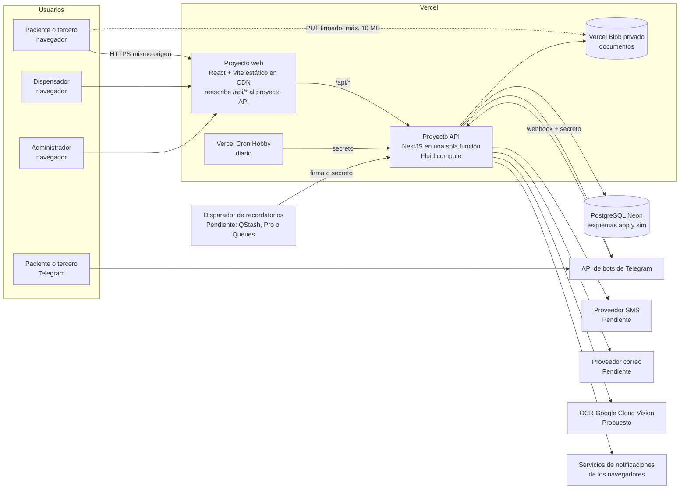

# Arquitectura: Pharma Express

Fuentes: `docs/00-contexto-producto.md` (versión 6, fuente de verdad), `docs/01-brief.md`, `docs/02-requisitos.md`, `feature_list.json` (F001 a F093) y `docs/guia-agentes.md` (sección architect). Stack y publicación fijos en `CLAUDE.md`: TypeScript, React + Vite, NestJS, PostgreSQL y Vercel.

Convención de estados: **Confirmado** (está en el contexto, los requisitos o `CLAUDE.md`, o lo verificó architect en la documentación oficial), **Inferido** (decisión o conclusión de architect que la usuaria debe confirmar), **Pendiente** (no decidido; requiere a la usuaria). Toda decisión técnica de este documento es Inferido mientras la usuaria no la apruebe, salvo que se indique otra cosa. Fecha de verificación de librerías y plataformas: 2026-10-31.

Nota sobre fuentes: `CLAUDE.md` cita "versión 3" del contexto; el archivo vigente es la versión 6. Donde difieren (por ejemplo, la excepción de la revocación al invariante 3), manda el contexto (sección 3.2), como indicó el orquestador.

## Visión general



Ideas rectoras:
- **Una sola función NestJS** atiende la API web, el webhook de Telegram y las tareas programadas (Confirmado por `CLAUDE.md` y por la documentación de Vercel: "your NestJS application becomes a single Vercel Function"). No hay procesos permanentes, ni polling del bot, ni `@nestjs/schedule`.
- **La base de datos es la última barrera** de los invariantes de reserva, consentimiento y retención: restricciones `CHECK`, claves foráneas con borrado en cascada, disparadores de restricción diferidos y transacciones (ADR 0004 y 0005).
- **El bot y la web usan los mismos servicios de aplicación**. El bot no llama a la API HTTP; llama en proceso a los mismos casos de uso con un `ChannelContext` (canal `telegram`, chat) que pasa por la misma política de acceso del paciente (ADR 0007 y 0008).
- **Los archivos nunca pasan por la función al subirse**: el navegador sube directo a Blob privado con una URL firmada que emite el backend después de autorizar (ADR 0012, RNF-027).
- **Mismo origen**: la web reescribe `/api/*` al proyecto API, para que las cookies sean de primera parte, `SameSite=Strict` funcione y CORS quede cerrado (ADR 0002).

## Componentes
| Componente | Responsabilidad | Tecnología | ADR |
| --- | --- | --- | --- |
| Web del paciente | Aviso de privacidad, verificación, vinculación, carga, prevalidación, agenda, citas, código de entrega, revocación, notificaciones web | React 19 + Vite 8, rutas con carga diferida, service worker solo para notificaciones | 0001, 0010, 0020 |
| Panel del dispensador | Inicio de sesión, validación del código, prevalidación, validación oficial y cierre | Misma app web, rutas `/dispensador/*` en un fragmento aparte | 0001, 0014, 0015 |
| Panel de administración | Puntos, horarios, ventanas, capacidad, inventario, catálogo de crónicos, trámites por EPS, cuentas, auditoría | Misma app web, rutas `/admin/*` en un fragmento aparte | 0001, 0014 |
| API NestJS | Casos de uso, guards, validación, transacciones, integraciones | NestJS 12 en Node.js 24.x, una sola función de Vercel | 0002, 0016 |
| Módulo de identidad | Consentimiento, código de un solo uso, huella de la cédula | NestJS + PostgreSQL | 0006, 0018 |
| Módulo de canales | Vinculación de navegador y chat, selección de paciente, desvinculación | NestJS + PostgreSQL | 0007 |
| Módulo de documentos | Intención de carga, URL firmada, validación por contenido, recodificación, OCR, cruce con la EPS simulada | `@vercel/blob`, `file-type`, `sharp`, `heic-convert`, `unpdf`, Google Cloud Vision | 0012 |
| Módulo de prevalidación | Afiliación, vigencia, PBS, autorización, habilitación de crónicos; todo o nada | NestJS, lectura del esquema `sim` | 0004, 0013 |
| Módulo de agenda | Disponibilidad, reserva atómica, citas, cancelación, expiración, máximo 2 solicitudes | PostgreSQL con bloqueos de fila y `CHECK` | 0005 |
| Módulo de entrega | Código QR y numérico, validación en el punto, validación oficial, cierre | NestJS + PostgreSQL | 0015 |
| Módulo de notificaciones | Bandeja de salida, plantillas sin datos sensibles, envío por web, Telegram, SMS y correo | `web-push`, grammY, proveedores SMS y correo | 0009, 0010 |
| Módulo de tareas | Despachador de tareas vencidas: recordatorios, reverificación, 48 h, crónicos, expiraciones, limpieza | Tabla `scheduled_jobs` + disparador externo | 0011 |
| Bot de Telegram | Recorrido completo por chat, por webhook | grammY 1.46 con adaptador `express` dentro de un controlador NestJS | 0008 |
| Personal y sesiones | Cuentas, contraseñas, sesiones, bloqueo, recuperación, enlaces de un solo uso | `@node-rs/argon2`, cookies `__Host-`, PostgreSQL | 0014, 0019 |
| Auditoría | Registro de solo inserción de acciones del personal | PostgreSQL con disparador que impide modificar | 0016 |
| Datos simulados | EPS, medicamentos, diagnósticos; semilla inicial de puntos e inventario | Esquema `sim`, archivos JSON validados | 0013 |
| Contrato | `api/openapi.yaml` y tipos generados | `openapi-typescript`, `openapi-fetch`, Redocly, Ajv | 0001 |

## Modelo de datos

PostgreSQL con dos esquemas (Inferido): `sim` (sistemas externos simulados, solo lectura para la aplicación en tiempo de ejecución) y `app` (datos propios de Pharma Express). Identificadores UUID aleatorios en todas las tablas expuestas por la API. Horas en `timestamptz`; fechas de servicio y horarios se interpretan en `America/Bogota` (Confirmado, RNF-017).

### Esquema `sim` (contenido lo arma la usuaria, sección 3.8)
| Tabla | Campos principales | Notas |
| --- | --- | --- |
| `affiliates` | id, cedula, full_name, eps (`salud_total`/`sanitas`), affiliation_status, mobile_phone, email (nulo) | Fuente de identidad y contacto. Nunca se modifica al revocar (Confirmado, sección 3.2) |
| `medications` | id, name, pbs_covered | Catálogo compartido con el inventario. Que la cobertura PBS sea un atributo del medicamento es Inferido |
| `diagnoses` | code, description | Códigos de diagnóstico de los datos simulados |
| `formulas` | id, affiliate_id, number, consultation_date, valid_until, diagnosis_code | La vigencia es dato de la EPS (Confirmado, sección 3.4) |
| `formula_items` | id, formula_id, medication_id, quantity | |
| `authorizations` | formula_item_id, status, valid_until | |
| `chronic_deliveries` | formula_id, next_enabled_date | Habilitación de entrega |

### Esquema `app`
| Tabla | Campos principales | Restricciones que protegen invariantes |
| --- | --- | --- |
| `consent_records` | id, kind (`data_processing`, `health_data`, `revocation`), cedula_fingerprint, declarant (`holder`, `third_party`, nulo en revocación), channel, notice_version, recorded_at | Sin clave foránea a ningún dato del paciente: sobrevive a la revocación. Solo inserción (disparador). La huella es HMAC-SHA-256 de la cédula con clave secreta (Inferido de "huella cifrada", sección 3.2) |
| `patient_refs` | id, cedula_fingerprint (único), sim_affiliate_id (único) | Referencia, no cuenta. Se crea al primer código correcto. Raíz de los borrados en cascada de la revocación |
| `otp_challenges` | id, cedula_fingerprint, purpose (`verify`, `revoke`), code_hash (nulo si la cédula no existe), expires_at, attempts_used, consumed_at, superseded_at, created_at | `CHECK attempts_used <= 3`; índice único parcial: un solo reto vigente por (huella, propósito) |
| `browser_devices` | id, token_hash (único), csrf_hash, push_subscription (jsonb, nulo), created_at, last_seen_at | Se crea solo al verificar la identidad (invariante 3) |
| `telegram_chats` | id, chat_id (único), conversation (jsonb), consent_snapshot (jsonb), last_update_id, updated_at | Se crea solo cuando la persona acepta el aviso o inicia la revocación; si rechaza, no se guarda nada |
| `channel_bindings` | id, patient_ref_id, browser_device_id o telegram_chat_id, created_at, expires_at, revoked_at | `CHECK` exactamente un canal; `CHECK expires_at = created_at + interval '3 months'`; único parcial por (canal, paciente) vigente; cascada desde `patient_refs` |
| `care_requests` | id, patient_ref_id, status (`open`, `closed`), created_at, closed_at | Disparador: máximo 2 abiertas por paciente, con bloqueo de la fila de `patient_refs` |
| `request_formulas` | id, request_id, sim_formula_id, treatment (`acute`, `chronic`), status, not_eligible_reason | Estados de la sección 3.5: carga, prevalidación, agenda, con cita, entregada, no apta, cancelada, perdida |
| `documents` | id, request_id, request_formula_id (nulo en historia clínica), kind, attempt_no, blob_path, status, rejection_reason | `CHECK attempt_no BETWEEN 1 AND 3`; único por (documento lógico, intento); único por solicitud para la historia clínica vigente |
| `document_extractions` | document_id, fields (jsonb), created_at | Solo campos extraídos útiles para el cruce; nunca en logs |
| `upload_events` | id, patient_ref_id, created_at | Límite de 20 archivos por paciente por hora |
| `prevalidation_results` | id, request_formula_id, steps (jsonb), outcome, preliminary, evaluated_at | `CHECK preliminary = true` (invariante 5) |
| `points` | id, name, active | Nombres ficticios |
| `point_schedules` | point_id, weekday, opens_at, closes_at | |
| `window_templates` | id, point_id, start_time, capacity, active | Ventana de 1 hora: `end_time = start_time + 1 h` (Confirmado, sección 3.5). Capacidad en citas (P7) |
| `window_slots` | id, window_template_id, point_id, service_date, starts_at, ends_at, capacity, booked_count | `CHECK 0 <= booked_count AND booked_count <= capacity`; único (plantilla, fecha). Se materializan para hoy y mañana |
| `inventory_items` | point_id, medication_id, on_hand, reserved | `CHECK 0 <= reserved AND reserved <= on_hand` |
| `appointments` | id, request_id, point_id, window_slot_id, status, delivery_code_ciphertext, delivery_code_lookup, booked_at, arrived_at, cancel_reason | Disparador de restricción diferido: una cita activa tiene al menos una línea reservada (invariante 2). Único parcial de `delivery_code_lookup` entre citas activas |
| `reservation_lines` | id, appointment_id, request_formula_id, medication_id, quantity, status, non_delivery_reason, non_delivery_description | `CHECK quantity > 0`; `CHECK` motivo obligatorio si no entregado; descripción obligatoria si el motivo es "otro" (Inferido, HU-026) |
| `official_validations` | appointment_id, dispenser_user_id, result, recorded_at | |
| `reverification_events` | id, request_formula_id, changed_field, detected_at | "Se registra qué dato cambió y cuándo" (sección 3.6) |
| `appointment_archive` | id, point_id, window_starts_at, service_date, outcome, reason | Lo único que queda de cada cita cancelada o entregada tras revocar (sección 3.2). Sin columnas de paciente |
| `scheduled_jobs` | id, kind, due_at, not_after, patient_ref_id, appointment_id, request_formula_id, status, attempts, locked_until, last_error_code | Cascada desde el paciente: revocar borra los recordatorios programados |
| `notification_outbox` | id, patient_ref_id, template, params (jsonb), status, attempts, created_at, sent_at | `params` solo admite claves de una lista cerrada por plantilla (ADR 0010) |
| `chronic_diagnoses` | code, added_at | Catálogo configurable |
| `eps_authorization_guides` | id, eps, kind (`point`, `link`, `procedure`), title, body, url, sort_order | |
| `staff_users` | id, email (único, sin distinguir mayúsculas), role, point_id, password_hash, active, failed_attempts, locked_until | `CHECK (role = 'dispenser') = (point_id IS NOT NULL)`; sin borrado (disparador impide `DELETE`) |
| `staff_sessions` | id, token_hash, user_id, role, created_at, last_activity_at, absolute_expires_at, csrf_hash, revoked_at | `CHECK absolute_expires_at <= created_at + interval '12 hours'` |
| `staff_tokens` | id, user_id, purpose (`setup`, `reset`), token_hash, expires_at, used_at, superseded_at | Único parcial: un token vigente por (usuario, propósito) |
| `password_reset_requests` | email_fingerprint, created_at | Límite de 3 por hora, también para correos inexistentes (P37, Propuesta) |
| `audit_events` | id, actor_user_id, actor_role, action, target_type, target_id, occurred_at, details (jsonb) | Solo inserción; `details` con claves permitidas, sin cédulas, diagnósticos ni medicamentos |

Relaciones clave: `patient_refs` 1:N `channel_bindings`, `care_requests`, `upload_events`, `scheduled_jobs`, `notification_outbox`; `care_requests` 1:N `request_formulas`, `documents`, `appointments`; `appointments` 1:N `reservation_lines`; una línea pertenece a una fórmula (una cita puede agrupar varias fórmulas, sección 3.5). Todas con `ON DELETE CASCADE` desde `patient_refs`, salvo `consent_records` y `appointment_archive`, que no tienen relación con el paciente.

## Autenticación, roles y autorización

| Actor | Credencial | Cómo se valida en cada petición | ADR |
| --- | --- | --- | --- |
| Paciente o tercero, web | Cookie `__Host-pe_device` (aleatoria, HttpOnly, Secure, SameSite=Strict) creada al verificar la identidad | `PatientChannelGuard`: busca el dispositivo por hash del token y exige una vinculación vigente (`revoked_at` nulo y `expires_at` futuro) al `patientRefId` de la ruta | 0007 |
| Paciente o tercero, Telegram | Chat de Telegram tras verificar con cédula y código | `PatientAccessPolicy` en la capa de servicios, con el mismo criterio de vinculación vigente. El chat nunca identifica por sí mismo (invariante 4) | 0007, 0008 |
| Antes de verificar | Cookie firmada `__Host-pe_consent` (sin registro en base de datos) con la aceptación del aviso | Requerida para pedir el código de verificación; no para la revocación | 0006, 0018 |
| Dispensador | Cookie `__Host-pe_staff` + token CSRF | `StaffSessionGuard` + `@Roles('dispenser')`; inactividad 30 min; punto leído de la base de datos en cada petición | 0014 |
| Administrador | Cookie `__Host-pe_staff` + token CSRF | `StaffSessionGuard` + `@Roles('admin')`; inactividad 15 min | 0014 |
| Telegram (servidor) | Cabecera `X-Telegram-Bot-Api-Secret-Token` | Comparación en tiempo constante antes de procesar | 0008 |
| Tareas programadas | `Authorization: Bearer CRON_SECRET` o firma del disparador externo | `JobSecretGuard` antes de ejecutar | 0011 |

Denegar por defecto (Confirmado, sección 3.13): un guard global rechaza toda ruta que no declare explícitamente `@Public()`, `@PatientChannel()`, `@Roles(...)`, `@TelegramWebhook()` o `@JobTrigger()`. Una prueba automatizada recorre todas las rutas registradas y falla si alguna no tiene una de esas marcas (ADR 0016). Mínimo privilegio: rutas `/api/v1/admin/*` solo admin, `/api/v1/dispenser/*` solo dispensador y además filtradas por el `point_id` vigente del dispensador; rutas de paciente nunca aceptan sesiones de personal.

## Seguridad

| Requisito (sección 3.13) | Mecanismo | RNF | ADR |
| --- | --- | --- | --- |
| 1. Autenticación y autorización en el backend en cada petición | Guards globales de NestJS; la interfaz no decide accesos; los estáticos de la CDN no contienen datos | RNF-007, RNF-026 | 0014, 0016 |
| 2. Denegar por defecto; paciente solo con vinculación vigente | Guard global con lista explícita de excepciones públicas; `PatientChannelGuard` y `PatientAccessPolicy` | RNF-007 | 0007, 0016 |
| 3. Mínimo privilegio; dispensador solo su punto | `@Roles`; consultas del panel del dispensador filtradas por `point_id` en SQL, no después | RNF-008 | 0014 |
| 4. Hash robusto, sesiones 12 h, inactividad 30/15 min, bloqueo 5 intentos 15 min, cookies HttpOnly/Secure/SameSite, CSRF, CORS propio | Argon2id (`@node-rs/argon2`); tabla `staff_sessions`; contador por cuenta; cookies `__Host-`; token CSRF sincronizado + verificación de `Origin`; CORS cerrado al mismo origen | RNF-009 | 0014, 0016 |
| 5. Límites de código, inicio de sesión y carga | Contadores en PostgreSQL por huella de cédula, por cuenta y por paciente (no en memoria: la función no tiene estado) | RNF-010 | 0006, 0012, 0014 |
| 6. Validación de entrada, consultas parametrizadas, archivos por contenido, nombre aleatorio, recodificación, almacenamiento privado, enlaces temporales | `ValidationPipe` global con lista blanca; Drizzle con parámetros; `file-type`, `unpdf`, `sharp`, `heic-convert`; Blob privado y URLs firmadas de vida corta | RNF-011 | 0012, 0016 |
| 7. HTTPS, HSTS, CSP, X-Content-Type-Options | `helmet` en la API; `headers` de `vercel.json` en el proyecto web (la CDN no pasa por NestJS) | RNF-012 | 0002, 0016 |
| 8. Secreto en webhook y tareas | `secretToken` de grammY y `JobSecretGuard` | RNF-013 | 0008, 0011 |
| 9. Auditoría de acciones del personal | Interceptor de auditoría en rutas de personal + tabla de solo inserción | RNF-014 | 0016 |
| 10. Registros sin cédulas, diagnósticos ni medicamentos | Logger con lista blanca de campos; nunca se registran cuerpos ni parámetros SQL; filtro de excepciones que oculta mensajes del controlador de base de datos | RNF-015 | 0016 |
| 11. Secretos solo en variables de entorno | `.env` local (no se lee ni se sube) y variables de Vercel; `.env.example` con nombres | RNF-016 | 0002 |

Otros controles: el pedido de código responde igual exista o no la cédula y envía el SMS y el correo después de responder (`waitUntil`) para que el tiempo de respuesta tampoco delate la afiliación (RNF-032, ADR 0006); respuestas con datos del paciente llevan `Cache-Control: no-store`; los enlaces de contraseña llevan el token en el fragmento (`#`) para que no quede en registros de servidor ni en `Referer` (ADR 0014).

## Publicación

| Pieza | Dónde | Detalle |
| --- | --- | --- |
| Web (paciente y paneles) | Proyecto Vercel `pharma-express-web`, raíz `apps/web` | Vite construye estáticos; `vercel.json` con reescritura de `/api/:path*` al proyecto API, cabeceras de seguridad y reescritura de rutas del SPA a `index.html` |
| API | Proyecto Vercel `pharma-express-api`, raíz `apps/api` | NestJS sin configuración (entrada `src/main.ts`), una sola función, Fluid compute, Node.js 24.x, región `iad1` por defecto (Inferido; la base de datos en la misma región) |
| Base de datos | Neon PostgreSQL desde el Marketplace de Vercel | Plan gratuito: 1 GB por proyecto, suspensión tras 5 minutos de inactividad (verificado en neon.com/pricing). Rama por entorno de vista previa (Inferido) |
| Archivos | Vercel Blob privado | Disponible en todos los planes; Hobby incluye 1 GB, 2.000 operaciones avanzadas y 10.000 simples al mes; si se exceden, Blob queda bloqueado 30 días (verificado) |
| Tareas | Vercel Cron Hobby (diario) + disparador preciso Pendiente | Ver ADR 0011 |
| Bot | Webhook `https://<api>/api/v1/telegram/webhook` registrado con `setWebhook` y `secret_token` | ADR 0008 |

Entornos (Inferido): local (Docker Compose con PostgreSQL, Blob y proveedores en modo de prueba), vista previa (por rama, base de datos de rama, proveedores en modo de prueba, bot de pruebas aparte) y producción (proveedores reales, contactos de prueba de la usuaria, sección 3.2).

Variables de entorno (nombres; valores solo en `.env` y Vercel): `DATABASE_URL`, `CEDULA_FINGERPRINT_KEY`, `OTP_PEPPER`, `DELIVERY_CODE_ENC_KEY`, `DELIVERY_CODE_LOOKUP_KEY`, `CONSENT_COOKIE_KEY`, `TELEGRAM_BOT_TOKEN`, `TELEGRAM_WEBHOOK_SECRET`, `CRON_SECRET`, `SCHEDULER_SIGNING_KEYS` (según opción del ADR 0011), `BLOB_READ_WRITE_TOKEN` u OIDC con `BLOB_STORE_ID`, `GOOGLE_VISION_CREDENTIALS`, `SMS_PROVIDER`, `SMS_API_KEY`, `SMS_SENDER`, `EMAIL_PROVIDER`, `EMAIL_API_KEY`, `EMAIL_FROM`, `VAPID_PUBLIC_KEY`, `VAPID_PRIVATE_KEY`, `VAPID_SUBJECT`, `APP_ORIGIN`, `MESSAGING_MODE` (`live`, `sandbox`, `capture`).

## Manejo de errores

- Un solo formato para toda la API: Problem Details (RFC 9457) con `application/problem+json`, esquema `Problem` en `api/openapi.yaml`, con `code` estable en inglés y `title`/`detail` en español de Colombia, más `nextSteps` (caminos de salida), `retryAfterSeconds` o `conflicts` cuando aplica.
- Códigos HTTP: 400 entrada inválida; 401 sin sesión o sesión vencida; 403 rol, punto o vinculación no permitidos; 404 recurso inexistente o ajeno (no se distingue para no filtrar existencia); 409 conflicto de negocio (cupo tomado, capacidad por debajo de lo reservado, límite de solicitudes); 410 código o enlace vencido o agotado; 413 archivo demasiado grande; 415 tipo no aceptado; 422 regla de negocio no cumplida; 429 límite de frecuencia con `Retry-After`; 502/503 proveedor externo caído.
- Un filtro global convierte toda excepción en `Problem`, sin mensajes internos ni datos de la petición; registra solo `code`, ruta plantilla, identificador de correlación y clase del error (ADR 0016).
- Integraciones externas: los envíos van a `notification_outbox` dentro de la transacción del caso de uso y se intentan después del commit; si fallan, el despachador reintenta con espera creciente (ADR 0010). OCR caído: el documento queda en `ocr_pending` y no consume carga (Inferido, ADR 0012).
- Telegram: el webhook responde 200 siempre que el secreto sea correcto, aun si el caso de uso falla, para que Telegram no reenvíe la actualización y bloquee el chat; el error se informa al usuario en el chat (Inferido, ADR 0008).

## Tareas programadas y en segundo plano
| Tarea | Cuándo se ejecuta | Qué hace | Fuente |
| --- | --- | --- | --- |
| Recordatorio del día anterior | Vencimiento a las 19:00 del día anterior; válido hasta las 21:00 | Envía el recordatorio si la cita sigue activa y se agendó antes de las 19:00 del día anterior; no en citas del mismo día | Sección 3.6, F044 |
| Recordatorio de dos horas antes y reverificación | Inicio de la ventana menos 2 h; tolerancia máxima 10 min | Reverifica afiliación, vigencia y autorizaciones; aplica cambios; envía recordatorio o aviso de cambio; no se programa si se agendó con menos de 2 h | Sección 3.6, F045, F046, F077 |
| Recordatorio de 48 horas sin disponibilidad | 48 h después de informar la espera | Envía un único recordatorio para volver a validar | Sección 3.5, F047 |
| Aviso de nueva prevalidación para crónicos | 2 días antes de la siguiente fecha habilitada | Envía el aviso; no crea citas | Sección 3.6, F048 |
| Expiración de reservas | Fin de la ventana | Marca la cita como expirada, libera cupo y existencias, pierde lo no recogido de fórmulas con entrega parcial, notifica | Sección 3.5, F039, F066 |
| Envío de notificaciones pendientes | Tras cada commit (`waitUntil`) y en cada despacho | Reintenta envíos fallidos de la bandeja de salida | Sección 3.6, F042 |
| Materialización de ventanas | Al consultar disponibilidad y en el despacho diario | Crea `window_slots` de hoy y mañana desde las plantillas | Sección 3.5 |
| Limpieza | Despacho diario | Borra retos de código vencidos, archivos huérfanos en cuarentena y tokens vencidos (plazos Inferidos) | Secciones 3.2 y 3.13 |

Todas las tareas pasan por un único despachador idempotente (`scheduled_jobs`, `FOR UPDATE SKIP LOCKED`); qué servicio lo dispara con la precisión exigida es la decisión Pendiente bloqueante del ADR 0011. La corrección de las reservas no depende del disparador: toda consulta de disponibilidad, toda edición del administrador y toda validación de código expiran primero, en la misma transacción, las citas cuya ventana ya terminó (ADR 0005).

## Estructura de carpetas del código

```text
/
├── api/openapi.yaml                 # contrato (architect)
├── apps/
│   ├── api/                         # NestJS (proyecto Vercel pharma-express-api)
│   │   ├── src/
│   │   │   ├── main.ts              # entrada detectada por Vercel
│   │   │   ├── common/              # guards, decoradores, filtros, interceptores, logger
│   │   │   ├── modules/
│   │   │   │   ├── identity/        # consentimiento, códigos, huellas
│   │   │   │   ├── channels/        # vinculaciones, dispositivos, chats
│   │   │   │   ├── documents/       # carga, validación, OCR, cruce
│   │   │   │   ├── prevalidation/
│   │   │   │   ├── scheduling/      # disponibilidad, reservas, citas
│   │   │   │   ├── delivery/        # código de entrega, panel del dispensador
│   │   │   │   ├── revocation/
│   │   │   │   ├── notifications/   # bandeja, plantillas, adaptadores de envío
│   │   │   │   ├── jobs/            # despachador
│   │   │   │   ├── telegram/        # bot grammY y conversaciones
│   │   │   │   ├── staff/           # cuentas, sesiones, contraseñas
│   │   │   │   ├── admin/           # configuración
│   │   │   │   ├── audit/
│   │   │   │   └── simulated/       # puertos y adaptadores de EPS e inventario simulados
│   │   │   └── db/                  # esquema Drizzle y cliente
│   │   ├── drizzle/                 # migraciones SQL versionadas
│   │   ├── seed/                    # cargador y esquemas de validación de la semilla
│   │   └── test/                    # integración y contrato contra PostgreSQL real
│   └── web/                         # React + Vite (proyecto Vercel pharma-express-web)
│       ├── src/
│       │   ├── patient/             # rutas del paciente
│       │   ├── dispenser/           # rutas /dispensador (carga diferida)
│       │   ├── admin/               # rutas /admin (carga diferida)
│       │   ├── shared/              # componentes accesibles, cliente API
│       │   └── sw.ts                # service worker de notificaciones
│       └── vercel.json              # reescrituras y cabeceras
├── packages/
│   └── api-contract/                # tipos generados de api/openapi.yaml y cliente openapi-fetch
├── data/simulated/                  # archivos JSON de la usuaria (EPS, medicamentos, puntos, inventario, catálogo)
├── e2e/                             # Playwright, axe y Lighthouse CI
├── docker-compose.yml               # PostgreSQL local
├── pnpm-workspace.yaml
└── .env.example
```

## Herramientas y comandos
| Para qué | Herramienta | Comando |
| --- | --- | --- |
| Gestor de paquetes | pnpm 12 (vía Corepack, campo `packageManager`) | `corepack enable && pnpm install` |
| Base de datos local | Docker Compose con PostgreSQL | `docker compose up -d db` |
| Migraciones | drizzle-kit 0.31 | `pnpm --filter api db:migrate` (genera: `pnpm --filter api db:generate`) |
| Datos simulados | Cargador propio validado | `pnpm --filter api db:seed` |
| Tipos del contrato | openapi-typescript 7.13 | `pnpm contract:gen` |
| Validar el contrato | Redocly CLI 2.72 | `pnpm contract:lint` |
| Desvío del contrato | Generación + `git diff --exit-code` + pruebas de contrato con Ajv | `pnpm contract:check` |
| Backend en local | NestJS (o `vercel dev`, CLI 48.4.0 o superior) | `pnpm --filter api dev` |
| Frontend en local | Vite | `pnpm --filter web dev` |
| Pruebas de backend | Vitest 5 + unplugin-swc + Supertest, contra PostgreSQL real | `pnpm --filter api test` |
| Pruebas de frontend | Vitest 5 + Testing Library + jsdom | `pnpm --filter web test` |
| Extremo a extremo y accesibilidad | Playwright 1.64 + @axe-core/playwright 4.14 | `pnpm e2e` |
| Rendimiento de laboratorio | Lighthouse CI 0.15 con 4G lenta | `pnpm perf` |
| Todo (lo usa `init.sh`) | | `pnpm install && docker compose up -d db && pnpm --filter api db:migrate && pnpm --filter api db:seed && pnpm contract:check && pnpm test` |

## Trazabilidad

Pantallas web del paciente: P-01 Inicio (aviso de privacidad y "Revocar mi autorización"), P-02 Verificación (cédula, código y caminos de salida), P-03 Pacientes vinculados (selección y desvinculación), P-04 Autorización de datos de salud, P-05 Solicitudes, P-06 Carga de documentos, P-07 Resultado preliminar ("procesando"), P-08 Disponibilidad y confirmación, P-09 Citas y código de entrega, P-10 Revocación, P-11 Notificaciones del navegador. Bot: B-01 a B-10, flujos equivalentes por chat (mismo número que la pantalla web). Personal: S-01 Definir contraseña, S-02 Recuperar contraseña. Dispensador: D-01 Inicio de sesión, D-02 Validar código, D-03 Cita (prevalidación, validación oficial y cierre). Administrador: A-01 Inicio de sesión, A-02 Puntos y horarios, A-03 Ventanas y capacidad, A-04 Inventario, A-05 Catálogo de crónicos, A-06 Trámites por EPS, A-07 Cuentas de dispensadores, A-08 Auditoría.

Prefijo de rutas omitido: todas empiezan por `/api/v1`. `{p}` = `patientRefId`, `{r}` = `requestId`, `{f}` = `formulaId`, `{a}` = `appointmentId`. "Webhook" = `POST /telegram/webhook` (el bot usa los mismos servicios en proceso).

| Funcionalidad | Endpoints | Pantallas |
| --- | --- | --- |
| F001 | `GET /privacy-notice`, `POST /consents/acceptance` | P-01 |
| F002 | Webhook (comando `/start`, botones de aceptación) | B-01 |
| F003 | `POST /identity/otp-requests`, `POST /identity/verifications` | P-02 |
| F004 | Webhook (cédula y código) | B-02 |
| F005 | `POST /identity/verifications` (410 con `nextSteps`), `POST /identity/otp-requests` (429) | P-02 |
| F006 | Webhook | B-02 |
| F007 | Webhook (`telegramSecret`) | Ninguna |
| F008 | Todas (cabeceras); `vercel.json` del proyecto web | Todas |
| F009 | `POST /identity/verifications`, `GET /me` | P-02, P-03 |
| F010 | Webhook | B-02, B-03 |
| F011 | `GET /me`, rutas `/patients/{p}/...` | P-03 |
| F012 | Webhook | B-03 |
| F013 | Todas las rutas `/patients/{p}/...` (403 sin vinculación vigente) | Todas las del paciente |
| F014 | Webhook (política de acceso por vinculación, no por identificadores de Telegram) | B-03 |
| F015 | `POST /patients/{p}/health-data-authorizations`, `POST /patients/{p}/requests/{r}/documents/upload-intents`, `POST .../documents/{d}/completion` | P-04, P-06 |
| F016 | Webhook | B-04, B-06 |
| F017 | `GET /patients/{p}/requests/{r}`, `POST .../upload-intents` (409 sin cargas) | P-06, P-07 |
| F018 | Webhook | B-06, B-07 |
| F019 | `POST .../upload-intents` (413, 415, 429), `POST .../completion` (415, 422) | P-06 |
| F020, F022, F024, F026 | `POST /patients/{p}/requests/{r}/prevalidation`, `GET /patients/{p}/requests/{r}` | P-07 |
| F021, F023, F025, F027 | Webhook | B-07 |
| F028 | `POST /patients/{p}/requests/{r}/formulas/{f}/availability-checks` | P-08 |
| F029 | Webhook | B-08 |
| F030, F080, F086 | `POST /patients/{p}/requests/{r}/formulas/{f}/confirmations` (409 con opciones actualizadas) | P-08 |
| F031, F081, F087 | Webhook | B-08 |
| F032 | `POST .../confirmations` (transacción atómica, ADR 0005) | P-08, B-08 |
| F033 | `POST .../availability-checks` (`no_availability`) | P-08 |
| F034 | Webhook | B-08 |
| F035 | `GET /patients/{p}/appointments`, `GET /patients/{p}/appointments/{a}` | P-09 |
| F036 | Webhook (QR enviado como imagen) | B-09 |
| F037 | `POST /patients/{p}/appointments/{a}/cancellation` | P-09 |
| F038 | Webhook | B-09 |
| F039 | `POST`/`GET /internal/jobs/dispatch` (expiración) y expiración perezosa | Ninguna |
| F040, F092 | `POST /revocations/otp-requests`, `POST /revocations` | P-01, P-10 |
| F041, F093 | Webhook | B-01, B-10 |
| F042, F066 | Bandeja de salida + `PUT /me/push-subscription` + despachador | P-11 |
| F043 | Plantillas de notificación (ADR 0010); enlaces al bot sin parámetros | Todas |
| F044, F045, F046, F047, F048, F077 | `/internal/jobs/dispatch` | Ninguna (mensajes) |
| F049 | `/internal/jobs/dispatch` (`jobSecret`) | Ninguna |
| F050 | `POST /staff/sessions`, `GET /staff/sessions/current`, `DELETE /staff/sessions/current` | D-01 |
| F051, F052 | Todas las rutas `/dispenser/*` (401, 403) | D-02, D-03 |
| F053 | `POST /dispenser/code-validations` | D-02 |
| F054 | `GET /dispenser/appointments/{a}`, `POST /dispenser/appointments/{a}/official-validation`, `POST /dispenser/appointments/{a}/line-closures` | D-03 |
| F055 | `POST /staff/sessions` (cookies), todas las rutas mutantes (CSRF) | D-01, A-01 |
| F056, F065 | Interceptor de auditoría en rutas `/dispenser/*`, `/admin/*`, `/staff/*` | Ninguna |
| F057 | Logger y auditoría (ADR 0016) | Ninguna |
| F058 | `POST /staff/sessions` (panel `admin`) | A-01 |
| F059 | Todas las rutas `/admin/*` (401, 403) | A-02 a A-08 |
| F060, F085 | `GET`/`POST /admin/points`, `PATCH /admin/points/{pointId}` (409 con ventanas afectadas) | A-02 |
| F061, F074 | `GET`/`POST /admin/points/{pointId}/windows`, `PATCH`/`DELETE /admin/windows/{windowId}` | A-03 |
| F062, F073 | `GET /admin/points/{pointId}/inventory`, `PUT /admin/points/{pointId}/inventory/{medicationId}`, `GET /admin/medications` | A-04 |
| F063 | `GET`/`POST /admin/chronic-diagnoses`, `DELETE /admin/chronic-diagnoses/{code}`, `GET /admin/diagnoses` | A-05 |
| F064 | `GET`/`PUT /admin/eps/{eps}/authorization-guides` | A-06 |
| F067 | `DELETE /me/bindings/{p}` | P-03 |
| F068 | Webhook | B-03 |
| F069 | `POST /patients/{p}/requests` (409) | P-05 |
| F070 | Webhook | B-05 |
| F071, F072, F079 | `GET`/`POST /admin/dispensers`, `PATCH /admin/dispensers/{id}` | A-07 |
| F075 | `GET /admin/audit-events` | A-08 |
| F076 | Todas las pantallas web | Todas |
| F078, F084 | `POST /admin/dispensers/{id}/setup-links`, `POST /staff/password-changes` | A-07, S-01 |
| F082, F083 | `POST /staff/password-resets`, `POST /staff/password-changes` | S-02, S-01 |
| F088 | Estáticos del proyecto web | Todas |
| F089 | `POST .../prevalidation`, `GET /patients/{p}/requests/{r}` (estado `processing`) | P-07 |
| F090 | Webhook (mensaje "procesando" y `waitUntil`) | B-07 |
| F091 | Todas las consultas normales | Todas |

Cobertura de requisitos: HU-001 a HU-036 y RNF-001 a RNF-032 quedan cubiertos a través de las funcionalidades (trazabilidad de `docs/02-requisitos.md`) y de los mecanismos de las secciones de seguridad y de los ADR 0004 a 0020.

## Riesgos técnicos
| Riesgo | Impacto | Mitigación |
| --- | --- | --- |
| Vercel Hobby solo permite tareas diarias con hasta 59 min de desfase; el recordatorio de 2 h admite 10 min (Confirmado) | F045, F046 y F077 no se cumplen sin un disparador preciso | ADR 0011: despachador independiente del disparador; la usuaria escoge entre QStash, Pro o Queues. **Pendiente bloqueante** |
| Notificaciones web en iPhone solo funcionan en apps web añadidas a la pantalla de inicio (WebKit); la app instalable está fuera de alcance (sección 3.10) | Navegadores iOS vinculados no reciben avisos web | Los demás medios siguen llegando; la usuaria decide si se acepta (Pendiente, ADR 0010) |
| Arranque en frío de NestJS y el límite de 3 s del bot (sección 3.15) | F090 | Fluid compute; respuesta inmediata con "procesando" y trabajo largo con `waitUntil`; `botInfo` precargado; medir en vista previa |
| OCR de fotos de baja calidad o comprimidas por Telegram | Más fórmulas no aptas | Pedir enviar como archivo en Telegram (Inferido); regla de 3 cargas |
| `heic-convert` tiene poca actividad de mantenimiento y Google Vision no lee HEIC | Fallo de HEIC | Pruebas con archivos HEIC reales de la usuaria; alternativa a evaluar si falla |
| Reescritura entre proyectos de Vercel para mismo origen no probada con cookies `__Host-` | Sesiones o CSRF fallan en producción | Prueba de humo en el primer despliegue de vista previa (ADR 0002); alternativa documentada |
| Límites gratuitos (Blob 1 GB y bloqueo 30 días al exceder; Resend 100 correos al día; Neon 1 GB; QStash 1.000 mensajes al día) | Corte del servicio en pruebas intensivas | Limpieza de cuarentena, captura local de mensajes en desarrollo, monitoreo de uso |
| Precio de Google Vision no verificado (la página oficial no cargó) | Costo desconocido | Pendiente: la usuaria confirma el proveedor y su costo (ADR 0012) |
| Errores del controlador de PostgreSQL pueden incluir parámetros (cédulas) | Fuga a logs (invariante 8) | Filtro de excepciones que nunca registra mensajes del controlador; prueba que busca datos de prueba en logs |
| Criterios exactos de "coincidencia con la EPS simulada" no definidos en el contexto | Resultados de OCR inconsistentes | Pendiente: la usuaria confirma qué campos se cruzan (ADR 0012) |
