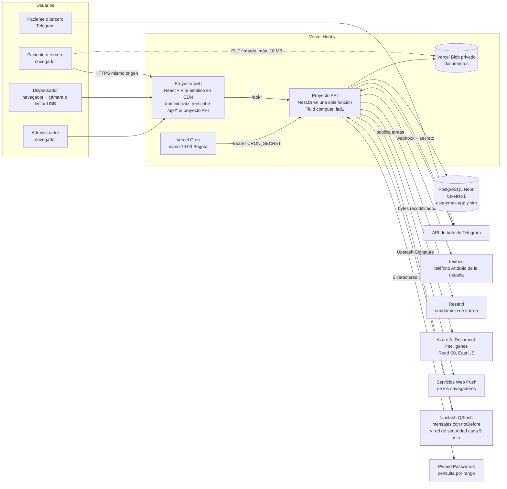

# Arquitectura: Pharma Express

Fuentes: `docs/00-contexto-producto.md` (versión 7, fuente de verdad), `docs/01-brief.md`, `docs/02-requisitos.md` (HU-001 a HU-038, RNF-001 a RNF-037, RP-01 a RP-03), `feature_list.json` (F001 a F100), `docs/04-readiness.md` (R-01 a R-24) y `docs/guia-agentes.md` (sección architect). Stack y publicación fijos en `CLAUDE.md`: TypeScript, React + Vite, NestJS, PostgreSQL y Vercel.

Convención de estados: **Confirmado** (está en el contexto, en los requisitos, en `CLAUDE.md`, lo decidió la usuaria o lo verificó architect en la documentación oficial), **Inferido** (conclusión que la usuaria debe confirmar), **Pendiente** (no decidido). El 2026-11-01 la usuaria aprobó en bloque las propuestas de architect, salvo la del ADR 0008, que cambió; por eso los 21 ADR están Aceptados. Las decisiones nuevas de este documento son **decisiones técnicas** (guía de agentes: las toma architect con la opción más simple y segura y las aprueba la compuerta 2 en bloque). Fecha de verificación de librerías y plataformas: 2026-10-31 y 2026-11-01.

## Visión general



Ideas rectoras:
- **Una sola función NestJS** atiende la API web, el webhook de Telegram y las tareas programadas (Confirmado por `CLAUDE.md` y la documentación de Vercel). No hay procesos permanentes, ni polling del bot, ni `@nestjs/schedule`.
- **La base de datos es la última barrera** de los invariantes de reserva, consentimiento y retención: restricciones `CHECK`, claves foráneas con borrado en cascada, disparadores diferidos, transacciones y un orden de bloqueo común (ADR 0004 y 0005).
- **Un solo reloj de negocio**, `app.clock_now()` en PostgreSQL, que las pruebas pueden adelantar fuera de producción (ADR 0021).
- **El bot y la web usan los mismos servicios de aplicación**, con un `ChannelContext` que pasa por la misma política de acceso del paciente (ADR 0007 y 0008).
- **Los archivos nunca pasan por la función al subirse**: subida directa a Blob privado con URL firmada que emite el backend después de autorizar (ADR 0012, RNF-027).
- **Mismo origen**: la web reescribe `/api/*` al proyecto API; cookies de primera parte, `SameSite=Strict` y CORS cerrado (ADR 0002).
- **Presupuesto de US$0**: solo planes gratuitos o cuentas de estudiante sin tarjeta (sección 3.9, RNF-036); todo se construye y se prueba en modo `capture` sin cuentas externas.

## Componentes
| Componente | Responsabilidad | Tecnología | ADR |
| --- | --- | --- | --- |
| Web del paciente | Aviso de privacidad, verificación, vinculación, autorización de datos de salud, solicitudes (crear, cancelar), carga, resultado preliminar, disponibilidad, volver a validar, citas y código de entrega, revocación con declaración, notificaciones | React 19 + Vite 8, rutas con carga diferida, service worker solo para notificaciones, sin manifiesto instalable | 0001, 0010, 0020 |
| Panel del dispensador | Inicio de sesión, validación del código (cámara del navegador o campo numérico con lector USB), prevalidación, validación oficial y cierre | Misma app web, rutas `/dispensador/*` en un fragmento aparte; `BarcodeDetector` o `barcode-detector` 3.2.3 cargado al pulsar | 0001, 0014, 0015 |
| Panel de administración | Puntos (crear, nombre y horario), ventanas y capacidad, inventario, catálogo de crónicos, trámites por EPS, cuentas, auditoría | Misma app web, rutas `/admin/*` en un fragmento aparte | 0001, 0014 |
| API NestJS | Casos de uso, guards, validación, transacciones, integraciones | NestJS 12 en Node.js 24.x, una sola función de Vercel, `rawBody: true` | 0002, 0016 |
| Reloj | Hora de negocio única y adelantable en pruebas | `app.clock_now()` + servicio `Clock` | 0021 |
| Identidad | Consentimiento, código de un solo uso (6 dígitos), huella HMAC de la cédula | NestJS + PostgreSQL | 0006, 0018 |
| Canales | Vinculación de navegador y chat, selección de paciente, desvinculación | NestJS + PostgreSQL | 0007 |
| Documentos | Texto y versión de la autorización de datos de salud, intención de carga, URL firmada, validación por contenido, recodificación, OCR, cruce con la EPS simulada | `@vercel/blob` 2.8, `file-type` 22.3, `sharp` 0.35, `heic-convert` 2.1, `unpdf` 2.1, `@azure-rest/ai-document-intelligence` 1.1 | 0012 |
| Prevalidación | Afiliación, vigencia, PBS, autorización, habilitación de crónicos; todo o nada; volver a validar sin OCR | NestJS, lectura del esquema `sim` | 0004, 0011, 0013 |
| Agenda y solicitudes | Disponibilidad, reserva atómica, citas, cancelación de citas y solicitudes, expiración, espera de 48 horas, máximo 2 abiertas | PostgreSQL con bloqueos de fila en orden común y `CHECK` | 0005, 0011 |
| Entrega | Código QR y numérico de 8 dígitos, validación en el punto, validación oficial con notas, cierre | NestJS + PostgreSQL | 0015, 0016 |
| Notificaciones | Bandeja de salida, plantillas cerradas (SMS de 160 caracteres sin tildes), envío por web, Telegram, SMS y correo | `web-push` 3.6.7, grammY, textbee (REST), `resend` 6.37 | 0009, 0010 |
| Tareas | Despachador de tareas vencidas: recordatorios, reverificación, 48 h, crónicos, cierre por inactividad, expiración, purgas, limpieza | Tabla `scheduled_jobs`; QStash (`@upstash/qstash` 2.12.1) y Vercel Cron | 0011 |
| Bot de Telegram | Recorrido completo por chat, por webhook; acepta fotos normales | grammY 1.46 con adaptador `express` dentro de un controlador NestJS | 0008 |
| Personal y sesiones | Cuentas, contraseñas (15 caracteres, sin filtradas), sesiones, bloqueo, recuperación, enlaces de un solo uso | `@node-rs/argon2` 2.2.2, Pwned Passwords, cookies `__Host-` | 0014, 0019 |
| Auditoría | Registro de solo inserción de acciones del personal, también en rutas públicas del personal | PostgreSQL con disparador que impide modificar | 0016 |
| Datos simulados y semillas | EPS, medicamentos, diagnósticos CIE-10; configuración inicial; administrador y dispensadores de prueba; comandos de existencias y cambios de EPS | Esquema `sim`, archivos JSON validados, comandos de `pnpm` | 0013 |
| Contrato | `api/openapi.yaml` y tipos generados | `openapi-typescript` 7.13, `openapi-fetch` 0.17, Redocly 2.72, Ajv 8.20 | 0001 |

Fuera del diseño: Google Cloud Vision y Twilio, reemplazados por Azure Read y textbee por decisión de la usuaria (ADR 0009 y 0012).

## Modelo de datos

PostgreSQL con dos esquemas: `sim` (sistemas externos simulados, solo lectura para la aplicación en tiempo de ejecución) y `app` (datos propios). Identificadores UUID aleatorios en todas las tablas expuestas por la API. Horas en `timestamptz` con `DEFAULT app.clock_now()` (ADR 0021); fechas de servicio y horarios se interpretan en `America/Bogota` (RNF-017).

### Esquema `sim` (contenido lo arma la usuaria, sección 3.8)
| Tabla | Campos principales | Notas |
| --- | --- | --- |
| `affiliates` | id, cedula, full_name, eps (`salud_total`/`sanitas`), affiliation_status, mobile_phone, email (nulo) | Fuente de identidad y contacto. Nunca se modifica al revocar (sección 3.2) |
| `medications` | id, code, name, pbs_covered | Catálogo compartido con el inventario |
| `diagnoses` | code (PK, CIE-10 con forma válida), description | **Ambos obligatorios** (`description NOT NULL`, no vacía): la coincidencia busca el código y, si no aparece, la descripción (sección 3.4; ADR 0013) |
| `formulas` | id, affiliate_id, number, consultation_date, valid_until, diagnosis_code (FK a `diagnoses`) | La vigencia es dato de la EPS (sección 3.4) |
| `formula_items` | id, formula_id, medication_id, quantity | |
| `authorizations` | formula_item_id, status, valid_until | |
| `chronic_deliveries` | formula_id, next_enabled_date | Habilitación de entrega |

### Esquema `app`
| Tabla | Campos principales | Restricciones que protegen invariantes |
| --- | --- | --- |
| `test_clock` | id (= 1), offset_seconds | Una fila; `offset_seconds >= 0`; disparador que rechaza un valor distinto de 0 si `pharma.environment = 'production'`; la aplicación solo lee (ADR 0021) |
| `consent_records` | id, kind (`data_processing`, `health_data`, `revocation`), cedula_fingerprint, declarant (`holder`, `third_party`), channel, notice_version, accepted_at, recorded_at | `declarant NOT NULL` en los tres tipos: en la revocación es lo que declaró quien revocó (R-01). `accepted_at NOT NULL` es la fecha y hora en que la persona aceptó (sección 3.2: "Se registra ... la fecha"); en `data_processing` sale de la cookie firmada `__Host-pe_consent` o de la conversación del bot, y `recorded_at` es la hora de la inserción, al verificar; en `health_data` y `revocation` las dos coinciden. `CHECK accepted_at <= recorded_at` (R-29). En `health_data`, `notice_version` es la versión del texto de la autorización de datos de salud. Sin clave foránea a datos del paciente: sobrevive a la revocación. Solo inserción. Huella HMAC-SHA-256 con clave secreta (R-24) |
| `patient_refs` | id, cedula_fingerprint (único), sim_affiliate_id (único) | Referencia, no cuenta. Se crea al primer código correcto. Raíz de los borrados en cascada de la revocación |
| `otp_challenges` | id, cedula_fingerprint, purpose (`verify`, `revoke`), code_hash (nulo si la cédula no existe), expires_at, attempts_used, consumed_at, superseded_at, created_at | `CHECK attempts_used <= 3`; índice único parcial: **un solo reto vigente por huella**, de cualquier propósito (R-19, ADR 0006) |
| `browser_devices` | id, token_hash (único), csrf_hash, push_subscription (jsonb, nulo), created_at, last_seen_at | Se crea solo al verificar la identidad (invariante 3) |
| `telegram_chats` | id, chat_id (único), conversation (jsonb: paso, paciente escogido, aceptación del aviso pendiente de verificar con versión, declaración y fecha, declaración de revocación), last_update_id, updated_at | Se crea solo cuando la persona acepta el aviso o inicia la revocación; la fila mínima de revocación se borra al terminar |
| `channel_bindings` | id, patient_ref_id, browser_device_id o telegram_chat_id, created_at, expires_at, revoked_at | `CHECK` exactamente un canal; `CHECK expires_at = created_at + interval '3 months'`; único parcial por (canal, paciente) vigente; cascada desde `patient_refs`. En el navegador, cada verificación correcta vuelve a emitir la cookie con el `expires_at` más tardío de sus vinculaciones vigentes (R-28, ADR 0007) |
| `care_requests` | id, patient_ref_id, status (`open`, `closed`), closed_reason (`completed`, `user_cancelled`, `inactivity`, nulo si abierta), last_activity_at, created_at, closed_at | Disparador: máximo 2 abiertas por paciente, con bloqueo de `patient_refs`. `CHECK (status = 'closed') = (closed_reason IS NOT NULL)`. `last_activity_at` se actualiza al crear, pedir una carga, completar una carga y pedir la prevalidación (HU-038) |
| `availability_waits` | id, request_id, started_at, revalidate_available_at, reminder_sent_at (nulo hasta enviar el recordatorio) | Una fila por validación que deja fórmulas sin disponibilidad: la consulta que sigue a la prevalidación (todas las fórmulas aptas a la vez), una `checkAvailability` de una fórmula que no esperaba o una `revalidateFormula` (ADR 0011, decisión 7). `CHECK revalidate_available_at = started_at + interval '48 hours'`. Cascada desde `care_requests` |
| `request_formulas` | id, request_id, sim_formula_id, treatment (`acute`, `chronic`), status, closed_reason, availability_wait_id (FK a la espera vigente, nulo si no espera), prevalidated_at | Estados (R-16): abiertos `loading`, `prevalidating`, `scheduling`, `scheduled`; finales `delivered`, `not_eligible`, `cancelled`, `lost`. `CHECK` motivo obligatorio si el estado es final (`delivered`, `delivered_with_exceptions`, `rule_failed`, `documents_failed`, `reverification_change`, `user_cancelled_request`, `user_cancelled_appointment`, `inactivity`, `not_collected`, `partially_collected`). `CHECK availability_wait_id IS NULL OR status = 'scheduling'`; la espera pertenece a la misma solicitud (FK compuesta `(availability_wait_id, request_id)`) |
| `documents` | id, request_id, request_formula_id (nulo en historia clínica), kind, attempt_no, source (`web`, `telegram_file`, `telegram_photo`), blob_path, ocr_operation_id (nulo tras borrar en Azure), status, rejection_reason | `CHECK attempt_no BETWEEN 1 AND 3`; único por (documento lógico, intento); una historia clínica vigente por solicitud. `source` permite al bot sugerir el envío como archivo si una foto falla (ADR 0008) |
| `document_extractions` | document_id, matched_sim_formula_id (nulo), cedula_matched (bool), diagnosis_matches (jsonb: por fórmula, `matched` y `method` `code`/`description`), rejection_reason, created_at | Solo el resultado del cruce. Nunca texto del OCR, cédula, número de fórmula, código ni descripción del diagnóstico, ni medicamentos (ADR 0012) |
| `upload_events` | id, patient_ref_id, created_at | Límite de 20 archivos por paciente por hora |
| `prevalidation_results` | id, request_formula_id, steps (jsonb), outcome, preliminary, evaluated_at, kind (`initial`, `revalidation`) | `CHECK preliminary = true` (invariante 5) |
| `points` | id, name | **Sin `active`** (R-09): un punto solo tiene nombre y horario; no se borra (disparador impide `DELETE`) |
| `point_schedules` | point_id, weekday (1 a 7), opens_at, closes_at | Un intervalo por día; día sin fila = sin atención; `CHECK opens_at < closes_at` |
| `window_templates` | id, point_id, start_time, capacity, active | Ventana de 1 hora (sección 3.5); capacidad en citas (P7); disparador impide desactivar con ventanas futuras reservadas |
| `window_slots` | id, window_template_id, point_id, service_date, starts_at, ends_at, capacity, booked_count | `CHECK 0 <= booked_count AND booked_count <= capacity`; único (plantilla, fecha). Solo se materializa si el horario del día contiene la ventana completa (R-22, ADR 0005) |
| `inventory_items` | point_id, medication_id, on_hand, reserved | `CHECK 0 <= reserved AND reserved <= on_hand` |
| `appointments` | id, request_id, point_id, window_slot_id, status (`active`, `attended`, `closed`, `cancelled`, `expired`), delivery_code_ciphertext, delivery_code_lookup, booked_at, arrived_at, cancel_reason | Disparador diferido: una cita activa tiene al menos una línea reservada (invariante 2). Único parcial de `delivery_code_lookup` entre citas activas. Código de 8 dígitos (ADR 0015) |
| `reservation_lines` | id, appointment_id, request_formula_id, medication_id, quantity, status (`reserved`, `delivered`, `not_delivered`, `released`, `lost`), non_delivery_reason, non_delivery_description | `CHECK quantity > 0`; motivo obligatorio si no entregado; descripción obligatoria si el motivo es "otro" |
| `official_validations` | appointment_id, dispenser_user_id, result (`valid`, `invalid`), notes (texto, máx. 500, nulo), recorded_at | `notes` nunca va a logs, auditoría ni archivo de citas; se borra en cascada con la cita (R-17, ADR 0016) |
| `reverification_events` | id, request_formula_id, changed_field, detected_at | "Se registra qué dato cambió y cuándo" (sección 3.6) |
| `appointment_archive` | id, point_id, window_starts_at, service_date, outcome, reason | Lo único que queda de cada cita cancelada o entregada tras revocar (sección 3.2). Sin columnas de paciente ni notas |
| `scheduled_jobs` | id, kind, due_at, not_after, status (`pending`, `done`, `cancelled`), patient_ref_id (nulo en purgas), request_id, request_formula_id, availability_wait_id, appointment_id, payload (jsonb: solo `operationId` o `blobPath` en purgas), attempts, locked_until, qstash_message_id, executed_at, outcome (`on_time`, `late_sent`, `late_skipped`, `noop`, `failed`), late_by_seconds, last_error_code | Cascada desde el paciente: revocar borra los recordatorios programados. Únicos parciales por `availability_wait_id` para `availability_48h` y para `formula_unscheduled_close` de espera, sin importar el estado: un solo recordatorio y un solo plazo por espera (sección 3.5; R-25, R-26). `CHECK availability_wait_id IS NOT NULL` en `availability_48h`; cascada desde `availability_waits` |
| `notification_outbox` | id, patient_ref_id (nulo tras enviar la confirmación de revocación), template, params (jsonb), status, attempts, created_at, sent_at | `params` solo admite claves de una lista cerrada por plantilla (ADR 0010) |
| `chronic_diagnoses` | code (FK a `sim.diagnoses`), added_at | Catálogo configurable |
| `eps_authorization_guides` | id, eps, kind (`point`, `link`, `procedure`), title, body, url, sort_order | |
| `staff_users` | id, email (único, sin distinguir mayúsculas), display_name, role, point_id, password_hash (nulo hasta definirla), active, failed_attempts, locked_until | `CHECK (role = 'dispenser') = (point_id IS NOT NULL)`; sin borrado (disparador impide `DELETE`) |
| `staff_sessions` | id, token_hash, user_id, role, created_at, last_activity_at, absolute_expires_at, csrf_hash, revoked_at | `CHECK absolute_expires_at <= created_at + interval '12 hours'` |
| `staff_tokens` | id, user_id, purpose (`setup`, `reset`), token_hash, expires_at, used_at, superseded_at | Único parcial: un token vigente por (usuario, propósito) |
| `password_reset_requests` | email_fingerprint, created_at | Límite de 3 por hora por correo ingresado, exista o no la cuenta (P37, Confirmado) |
| `audit_events` | id, actor_user_id (nulo si la cuenta no existe o es `system`), actor_role (`dispenser`, `admin`, `system`, nulo si la cuenta no existe), action, result (`success`, `rejected`), target_type, target_id, occurred_at, details (jsonb) | `result NOT NULL`; `CHECK`: `actor_user_id` no nulo si y solo si `actor_role` es `dispenser` o `admin` (R-30; contrato `AuditEvent`). Solo inserción; `details` con claves permitidas (por ejemplo, `emailFingerprint`, `hasNotes`, `rejectionCode`), sin cédulas, diagnósticos, medicamentos, tokens ni notas |

Relaciones clave: `patient_refs` 1:N `channel_bindings`, `care_requests`, `upload_events`, `scheduled_jobs`, `notification_outbox`; `care_requests` 1:N `request_formulas`, `documents`, `appointments`, `availability_waits`; `availability_waits` 1:N `request_formulas` (las que esperan en ella) y 1:0..2 `scheduled_jobs` (recordatorio y plazo); `appointments` 1:N `reservation_lines` y 1:0..1 `official_validations`; una línea pertenece a una fórmula (una cita puede agrupar varias fórmulas, sección 3.5). Todas con `ON DELETE CASCADE` desde `patient_refs`, salvo `consent_records`, `appointment_archive` y las tareas de purga, que no tienen relación con el paciente.

### Estados de la solicitud y de la fórmula (R-16)
| Sección 3.5 | `request_formulas.status` | Cuenta como abierta | Cómo se llega |
| --- | --- | --- | --- |
| Carga | `loading` | Sí | Al crear la fórmula con su primera carga |
| Prevalidación | `prevalidating` | Sí | Al pedir la prevalidación (incluye el OCR pendiente) |
| Agenda | `scheduling` | Sí | Apta sin cita; también durante la espera de 48 horas (`availability_wait_id` apunta a su espera vigente) |
| Con cita activa | `scheduled` | Sí | Al confirmar; sigue así mientras tenga alguna cita activa |
| Entregada | `delivered` (`delivered` o `delivered_with_exceptions`) | No | El dispensador cerró todas sus líneas en el punto; si alguna quedó no entregada, la fórmula se cierra igual (HU-026) |
| No apta | `not_eligible` | No | Regla de prevalidación, tercera carga fallida o reverificación |
| Cancelada | `cancelled` | No | El usuario cancela la solicitud o la única cita sin haber recibido nada, o cierre por inactividad |
| Perdida | `lost` | No | Expira la cita sin recoger, o se cancela o expira el resto tras una entrega parcial |

Que "entregada con algún medicamento no entregado" use el estado `delivered` con motivo `delivered_with_exceptions` es una decisión técnica de estados internos: el contexto la cuenta como cerrada y el detalle está en las líneas. La solicitud está `open` mientras alguna fórmula esté en un estado abierto y pasa a `closed` cuando todas están en un estado final; su `closed_reason` es el del evento que cerró la última fórmula abierta (`user_cancelled`, `inactivity` o `completed`).

## Autenticación, roles y autorización

| Actor | Credencial | Cómo se valida en cada petición | ADR |
| --- | --- | --- | --- |
| Paciente o tercero, web | Cookie `__Host-pe_device` (aleatoria, HttpOnly, Secure, SameSite=Strict) creada al verificar la identidad y emitida de nuevo en cada verificación correcta, con el vencimiento de la vinculación vigente más tardía (R-28) | `PatientChannelGuard`: dispositivo por hash del token y vinculación vigente (`revoked_at` nulo y `expires_at > app.clock_now()`) al `patientRefId` de la ruta | 0007 |
| Paciente o tercero, Telegram | Chat de Telegram tras verificar con cédula y código | `PatientAccessPolicy` en la capa de servicios, con el mismo criterio. El chat nunca identifica por sí mismo (invariante 4) | 0007, 0008 |
| Antes de verificar | Cookie firmada `__Host-pe_consent` (sin registro en base de datos) con la aceptación del aviso, la declaración y la fecha y hora de la aceptación; en el bot, lo mismo en la conversación. Al verificar, esa fecha va a `consent_records.accepted_at` (R-29) | Requerida para pedir el código de verificación; no para la revocación | 0006, 0018 |
| Revocación | Cédula + código de revocación de 6 dígitos + declaración titular o tercero | Sin cookie ni vinculación; solo el código correcto (RNF-007) | 0006, 0018 |
| Dispensador | Cookie `__Host-pe_staff` + token CSRF | `StaffSessionGuard` + `@Roles('dispenser')`; inactividad 30 min; punto leído de la base en cada petición | 0014 |
| Administrador | Cookie `__Host-pe_staff` + token CSRF | `StaffSessionGuard` + `@Roles('admin')`; inactividad 15 min | 0014 |
| Telegram (servidor) | Cabecera `X-Telegram-Bot-Api-Secret-Token` | Comparación en tiempo constante antes de procesar | 0008 |
| Tareas programadas | `Authorization: Bearer CRON_SECRET` o `Upstash-Signature` | `JobSecretGuard`; la firma se verifica sobre el cuerpo crudo | 0011, 0016 |

Denegar por defecto (sección 3.13): un guard global rechaza toda ruta sin `@Public()`, `@PatientChannel()`, `@Roles(...)`, `@TelegramWebhook()` o `@JobTrigger()`; una prueba recorre las rutas registradas y falla si alguna no tiene marca o si una ruta pública no está en la lista aprobada (ADR 0016). Mínimo privilegio: `/api/v1/admin/*` solo admin; `/api/v1/dispenser/*` solo dispensador, filtrado en SQL por su `point_id`; rutas de paciente nunca aceptan sesiones de personal.

## Seguridad

| Requisito (sección 3.13) | Mecanismo | RNF | ADR |
| --- | --- | --- | --- |
| 1. Autenticación y autorización en el backend en cada petición | Guards globales de NestJS; la interfaz no decide accesos; los estáticos de la CDN no contienen datos | RNF-007, RNF-026 | 0014, 0016 |
| 2. Denegar por defecto; paciente solo con vinculación vigente | Guard global con lista explícita de rutas públicas; `PatientChannelGuard` y `PatientAccessPolicy` | RNF-007 | 0007, 0016 |
| 3. Mínimo privilegio; dispensador solo su punto | `@Roles`; consultas del dispensador filtradas por `point_id` en SQL | RNF-008 | 0014 |
| 4. Hash robusto, sesiones 12 h, inactividad 30/15 min, bloqueo 5 intentos 15 min, cookies, CSRF, CORS | Argon2id; contraseña de mínimo 15 caracteres sin reglas de composición y sin filtradas o comunes (Pwned Passwords por rango, falla cerrada); `staff_sessions`; contador por cuenta con respuesta genérica 401; cookies `__Host-`; token CSRF + `Origin` (el control de `Origin` aplica a las mutaciones del navegador, no al webhook ni al despachador, R-31); CORS cerrado | RNF-009, RNF-035 | 0014, 0016 |
| 5. Límites de código, inicio de sesión y carga; cada código nuevo anula el anterior | Contadores en PostgreSQL por huella de cédula (un reto vigente por huella, de cualquier propósito), por cuenta y por paciente | RNF-010 | 0006, 0012, 0014 |
| 6. Validación de entrada, consultas parametrizadas, archivos por contenido, nombre aleatorio, recodificación, almacenamiento privado, enlaces temporales | `ValidationPipe` con lista blanca; Drizzle; `file-type`, `unpdf`, `sharp`, `heic-convert`; Blob privado y URL firmadas de vida corta | RNF-011 | 0012, 0016 |
| 7. HTTPS, HSTS, CSP, X-Content-Type-Options | `helmet` en la API; `vercel.json` en la web, con `Permissions-Policy: camera=(self)` y `'wasm-unsafe-eval'` para el lector de QR | RNF-012 | 0002, 0016 |
| 8. Secreto en webhook y tareas | `secretToken` de grammY; `JobSecretGuard` con bearer o firma de QStash sobre el cuerpo crudo | RNF-013 | 0008, 0011, 0016 |
| 9. Auditoría de acciones del personal | Interceptor en rutas `@Roles` más registro explícito en las rutas públicas del personal: inicio de sesión (éxito, fallo, bloqueo), recuperación y definición o cambio de contraseña (R-15) | RNF-014 | 0016 |
| 10. Registros sin cédulas, diagnósticos ni medicamentos | `SafeLogger` con lista blanca; nunca cuerpos (tampoco el crudo), parámetros SQL ni notas de validación oficial; incumplimientos de recordatorios solo con tipo, resultado y retraso | RNF-015 | 0011, 0016 |
| 11. Secretos solo en variables de entorno | `.env` local (no se lee ni se sube) y variables de Vercel; `.env.example` con nombres | RNF-016 | 0002 |

Otros controles: el pedido de código responde igual exista o no la cédula y envía después de responder (`waitUntil`), para que el tiempo tampoco delate la afiliación (RNF-032); el inicio de sesión del personal calcula un hash aun para cuentas inexistentes; respuestas con datos del paciente llevan `Cache-Control: no-store`; los enlaces de contraseña llevan el token en el fragmento (`#`).

## Publicación

| Pieza | Dónde | Detalle |
| --- | --- | --- |
| Web (paciente y paneles) | Proyecto Vercel `pharma-express-web`, raíz `apps/web`, dominio raíz | Vite construye estáticos; `vercel.json` reescribe `/api/:path*` al proyecto API, pone cabeceras de seguridad y reescribe rutas del SPA a `index.html` |
| API | Proyecto Vercel `pharma-express-api`, raíz `apps/api`, región `iad1` | NestJS sin configuración (entrada `src/main.ts`), una sola función, Fluid compute, Node.js 24.x |
| Base de datos | Neon PostgreSQL (Marketplace de Vercel), AWS `us-east-1` | Plan gratuito: 1 GB, suspensión tras 5 minutos de inactividad; rama por vista previa |
| Archivos | Vercel Blob privado | Hobby: 1 GB, 2.000 operaciones avanzadas y 10.000 simples al mes; bloqueo de 30 días si se exceden |
| OCR | Azure AI Document Intelligence, Read S0, East US | Crédito de Azure for Students; Delete Analyze Result tras leer |
| Tareas | QStash (mensajes y red de 5 minutos) + Vercel Cron diario | ADR 0011 |
| SMS y correo | textbee (teléfono Android) y Resend (subdominio de correo) | ADR 0009 |
| Bot | Webhook `https://<dominio>/api/v1/telegram/webhook` registrado con `setWebhook` y `secret_token` | ADR 0008 |

Entornos y modos por entorno: tabla del ADR 0002 (decisión 6). En resumen: local y vista previa trabajan con `MESSAGING_MODE=capture`, `OCR_PROVIDER=capture` y `SCHEDULER_MODE=direct` por defecto, con reloj de prueba y semilla de dispensadores; producción usa `live`, `azure` y `qstash`, sin reloj de prueba ni dispensadores de prueba.

### Presupuesto de US$0 (sección 3.9, RNF-036)
| Servicio | Plan | Costo | Límite que importa | Verificado |
| --- | --- | --- | --- | --- |
| Vercel (web, API, Blob, Cron) | Hobby | US$0 | Cron diario; Blob 1 GB; función 300 s | Sí (2026-10-31) |
| Neon | Gratuito | US$0 | 1 GB; suspensión a los 5 min | Sí |
| Upstash QStash | Gratuito | US$0 | 1.000 mensajes al día; 10 programaciones; retraso máximo 7 días | Sí; falta confirmar que no pide tarjeta |
| textbee | Gratuito | US$0 (los SMS salen del plan de telefonía de la usuaria) | 50 SMS al día, 300 al mes | Sí; falta confirmar el plan de telefonía |
| Resend | Gratuito | US$0 | 100 correos al día, 3.000 al mes | Sí; falta confirmar que no pide tarjeta |
| Azure Document Intelligence Read S0 | Azure for Students | Crédito de estudiante (US$100, sin tarjeta) | Si el crédito se agota, el recurso se desactiva (no cobra) | Crédito sí; precio por página no publicado en la página oficial |
| Dominio | GitHub Student Developer Pack | US$0 el primer año | La renovación puede costar | Sí (oferta del pack) |
| Telegram Bot API, Web Push, Pwned Passwords | Gratuitos | US$0 | Pwned Passwords sin clave ni límite | Sí |

Ningún servicio escogido exige pago. Las condiciones por confirmar están en "Configuración antes de publicar".

### Configuración antes de publicar
No bloquea la construcción: todo se construye y se prueba en modo `capture`, con OCR simulado, `SCHEDULER_MODE=direct` y datos simulados (guía de agentes; RNF-036). La hace la usuaria antes de publicar:
1. **Cuentas sin tarjeta:** textbee, Resend, Upstash QStash y Azure for Students. Si alguna pide tarjeta, se vuelve a decidir (choca con la sección 3.9).
2. **Dominio:** registrar un dominio del GitHub Student Developer Pack, apuntar el dominio raíz al proyecto web de Vercel y verificar en Resend el subdominio de correo (por ejemplo, `correo.<dominio>`, remitente `notificaciones@correo.<dominio>`).
3. **Teléfono Android** con la aplicación de textbee, encendido, cargando y con conexión durante pruebas y demostración, y confirmación de que el plan de telefonía incluye los SMS salientes sin costo adicional.
4. **Azure:** crear el recurso Document Intelligence S0 en East US con Azure for Students, confirmar que Read 2024-11-30 está disponible en esa región para la suscripción y revisar el precio de Read S0 en el portal o la calculadora.
5. **Upstash:** crear la programación de la red de seguridad (cada 5 minutos) hacia `POST /api/v1/internal/jobs/dispatch` y copiar las claves de firma.
6. **Telegram:** crear el bot de producción y el de pruebas con BotFather y registrar el webhook con el secreto.
7. **Base de producción:** ejecutar `ALTER DATABASE ... SET pharma.environment = 'production'` (ADR 0021) y crear el primer administrador con `db:seed-staff`.
8. **Variables de entorno** de producción en el panel de Vercel (lista abajo).
9. **Datos simulados** (sección 3.8): EPS, inventario, puntos, catálogo y documentos de prueba con número de fórmula, cédula y código CIE-10 o descripción de cada diagnóstico.

### Variables de entorno
Nombres; los valores solo en `.env` y Vercel.

| Grupo | Variables |
| --- | --- |
| Base y reloj | `DATABASE_URL`, `DATABASE_SEED_URL` (usuario de semilla, nunca en la función de producción) |
| Claves propias | `CEDULA_FINGERPRINT_KEY`, `EMAIL_FINGERPRINT_KEY`, `OTP_PEPPER`, `DELIVERY_CODE_ENC_KEY`, `DELIVERY_CODE_LOOKUP_KEY`, `CONSENT_COOKIE_KEY` |
| Web y API | `APP_ORIGIN`, `PUBLIC_API_URL` |
| Telegram | `TELEGRAM_BOT_TOKEN`, `TELEGRAM_WEBHOOK_SECRET`, `TELEGRAM_BOT_USERNAME` |
| Tareas | `CRON_SECRET`, `SCHEDULER_MODE` (`qstash`, `direct`), `QSTASH_TOKEN`, `QSTASH_CURRENT_SIGNING_KEY`, `QSTASH_NEXT_SIGNING_KEY` |
| Archivos | `BLOB_READ_WRITE_TOKEN` |
| OCR | `OCR_PROVIDER` (`azure`, `capture`), `AZURE_DOCUMENT_INTELLIGENCE_ENDPOINT`, `AZURE_DOCUMENT_INTELLIGENCE_KEY` |
| Mensajería | `MESSAGING_MODE` (`live`, `sandbox`, `capture`), `MESSAGING_ALLOWLIST`, `SMS_PROVIDER` (`textbee`, `capture`), `TEXTBEE_API_KEY`, `TEXTBEE_DEVICE_ID`, `EMAIL_PROVIDER` (`resend`, `capture`), `RESEND_API_KEY`, `EMAIL_FROM` |
| Notificaciones web | `VAPID_PUBLIC_KEY`, `VAPID_PRIVATE_KEY`, `VAPID_SUBJECT` |
| Contraseñas | `PASSWORD_BREACH_CHECK` (`pwned`, `capture`) |
| Semillas (solo comandos) | `SEED_ADMIN_EMAIL`, `SEED_DISPENSER_EMAILS`, `SEED_DISPENSER_PASSWORD` (solo local y vista previa) |

Las versiones de los textos (aviso de privacidad y autorización de datos de salud) viven en el código, no en variables.

## Manejo de errores

- Un solo formato: Problem Details (RFC 9457), `application/problem+json`, esquema `Problem` de `api/openapi.yaml`, con `code` estable en inglés, `title`/`detail` en español de Colombia y, cuando aplica, `nextSteps`, `retryAfterSeconds`, `attemptsRemaining` o los datos del conflicto.
- Códigos HTTP: 400 entrada inválida (incluye campos no previstos, como `active` en un punto); 401 sin sesión, sesión vencida o credenciales inválidas (siempre genérico en el inicio de sesión del personal); 403 rol, punto o vinculación no permitidos; 404 recurso inexistente o ajeno; 409 conflicto de negocio (cupo tomado, capacidad por debajo de lo reservado, horario que deja fuera citas activas, límite de solicitudes, solicitud cerrada, versión de texto vencida, contraseña ya definida); 410 código o enlace vencido o agotado; 413 archivo demasiado grande; 415 tipo no aceptado; 422 regla de negocio no cumplida (por ejemplo, contraseña que no cumple la política o volver a validar antes de las 48 horas); 429 límite de frecuencia con `Retry-After` (códigos y cargas); 502/503 proveedor externo caído (por ejemplo, `password_check_unavailable`).
- Un filtro global convierte toda excepción en `Problem`, sin mensajes internos ni datos de la petición; registra solo `code`, ruta plantilla, id de correlación y clase del error (ADR 0016).
- Integraciones: los envíos van a `notification_outbox` dentro de la transacción y se intentan después del commit; si fallan, el despachador reintenta hasta 5 veces con espera creciente; al llegar a la cuota del plan gratuito quedan `failed` con `quota_exhausted` (ADR 0009 y 0010). OCR caído: el documento queda `ocr_pending` y no consume carga (ADR 0012). Pwned Passwords caído: 503 y el enlace no se consume (ADR 0014).
- Telegram: con secreto correcto el webhook responde 200 aunque el caso de uso falle; el error se informa en el chat (ADR 0008).

## Tareas programadas y en segundo plano
| Tarea | Cuándo se ejecuta | Qué hace | Fuente |
| --- | --- | --- | --- |
| Recordatorio del día anterior | 19:00 del día anterior; válido hasta las 21:00 | Envía si la cita sigue activa y se agendó antes de las 19:00 del día anterior; no en citas del mismo día | Sección 3.6, F044 |
| Recordatorio de dos horas antes y reverificación | Inicio de la ventana menos 2 h; tolerancia 10 min | Reverifica y envía; tarde y sin empezar: envía y reverifica (`late_sent`); ya empezó: omite sin reverificar (`late_skipped`); ambos son incumplimiento | Sección 3.6, F045, F046, F077 |
| Recordatorio de 48 horas | Inicio de la espera (`availability_waits.started_at`) + 48 h; franja [21:00, 7:00) pasa a las 7:00; tolerancia 1 h | Uno por espera, compartido por las fórmulas que quedaron esperando en la misma validación; una espera nueva al volver a validar tiene el suyo. Solo sale si alguna fórmula sigue en esa espera. Si sale tarde por una falla, se envía igual (`late_sent`, incumplimiento) | Sección 3.5, F047 |
| Aviso de nueva prevalidación para crónicos | 19:00 del día que está 2 días antes de la siguiente fecha habilitada (cron diario) | Envía el aviso; no crea citas | Sección 3.6, F048 |
| Cierre de solicitud por inactividad | `last_activity_at` + 24 h | Cancela las fórmulas en carga o prevalidación; sin notificación | Sección 3.5, F098 |
| Cierre de fórmula apta sin cita | Sin espera: prevalidación + 24 h, o volver a validar con disponibilidad + 24 h (Inferido, HU-038 criterio 2). En espera: envío del recordatorio de su espera + 24 h, una tarea por espera | Cancela las fórmulas que siguen sin cita (en espera, solo las que siguen en esa espera); nunca cancela citas; sin notificación | Sección 3.5, F098 |
| Expiración de reservas | Fin de la ventana (y expiración perezosa) | Expira, libera cupo y existencias, pierde lo no recogido, notifica | Sección 3.5, F039, F066, F099 |
| Envío de notificaciones pendientes | Tras cada commit (`waitUntil`) y en cada despacho | Reintenta la bandeja de salida | Sección 3.6, F042 |
| Materialización de ventanas | Al consultar disponibilidad y en el despacho diario | Crea `window_slots` de hoy y mañana según el horario de cada día | Sección 3.5, ADR 0005 |
| Purgas tras revocar | Inmediato, con reintentos | Borra archivos de Blob y resultados de Azure que no se pudieron borrar en el momento | Sección 3.2, ADR 0018 |
| Limpieza | Despacho diario | Retos de código 24 h después de vencer, cuarentena huérfana, tokens vencidos | Secciones 3.2 y 3.13 |

Todas las tareas pasan por un único despachador idempotente (`scheduled_jobs`, `FOR UPDATE SKIP LOCKED`, `due_at <= app.clock_now()`). La corrección de las reservas no depende del disparador: toda consulta de disponibilidad, edición del administrador y validación de código expiran primero las citas cuya ventana ya terminó (ADR 0005).

## Pruebas de tiempo y datos de prueba (R-06, RP-01 a RP-03)
- **Tiempo (ADR 0021):** `pnpm --filter api test:clock advance <duración> | set <segundos> | reset` adelanta `app.clock_now()` fuera de producción; después, la prueba llama al despachador con `CRON_SECRET`. Para simular retrasos por falla, se adelanta más allá de `not_after` sin despachar antes. Límites: solo hacia adelante, global para la base (pruebas en serie), y no mueve relojes externos (URL de Blob, cookies, QStash, Telegram).
- **Dispensadores de prueba (ADR 0013, decisión 6):** `pnpm --filter api db:seed-staff` crea el administrador y, solo en local y vista previa, dos dispensadores activos con contraseña en los dos primeros puntos.
- **Existencias y cambios de EPS (ADR 0013, decisión 7):** `sim:stock` y `sim:apply`, solo fuera de producción, sin notificaciones.

## Estructura de carpetas del código

```text
/
├── api/openapi.yaml                 # contrato (architect)
├── apps/
│   ├── api/                         # NestJS (proyecto Vercel pharma-express-api)
│   │   ├── src/
│   │   │   ├── main.ts              # entrada detectada por Vercel (rawBody: true)
│   │   │   ├── common/              # guards, decoradores, filtros, interceptores, logger, Clock
│   │   │   ├── modules/
│   │   │   │   ├── identity/        # consentimiento, códigos, huellas
│   │   │   │   ├── channels/        # vinculaciones, dispositivos, chats
│   │   │   │   ├── documents/       # texto de autorización de salud, carga, validación, OCR, cruce
│   │   │   │   ├── prevalidation/   # prevalidación y volver a validar
│   │   │   │   ├── scheduling/      # solicitudes, disponibilidad, reservas, citas, cancelaciones
│   │   │   │   ├── delivery/        # código de entrega, panel del dispensador
│   │   │   │   ├── revocation/
│   │   │   │   ├── notifications/   # bandeja, plantillas, adaptadores (web push, Telegram, textbee, Resend, capture)
│   │   │   │   ├── jobs/            # despachador, QStash, cron
│   │   │   │   ├── telegram/        # bot grammY y conversaciones
│   │   │   │   ├── staff/           # cuentas, sesiones, contraseñas, Pwned Passwords
│   │   │   │   ├── admin/           # configuración
│   │   │   │   ├── audit/
│   │   │   │   └── simulated/       # puertos y adaptadores de EPS e inventario simulados
│   │   │   └── db/                  # esquema Drizzle y cliente
│   │   ├── drizzle/                 # migraciones SQL versionadas (incluye app.clock_now)
│   │   ├── scripts/                 # db:seed, db:seed-staff, sim:stock, sim:apply, test:clock
│   │   └── test/                    # integración y contrato contra PostgreSQL real
│   └── web/                         # React + Vite (proyecto Vercel pharma-express-web)
│       ├── src/
│       │   ├── patient/             # rutas del paciente
│       │   ├── dispenser/           # rutas /dispensador (carga diferida; lector de QR aparte)
│       │   ├── admin/               # rutas /admin (carga diferida)
│       │   ├── shared/              # componentes accesibles, cliente API
│       │   └── sw.ts                # service worker de notificaciones
│       ├── public/zxing/            # WebAssembly del lector de QR servido desde el propio dominio
│       └── vercel.json              # reescrituras y cabeceras
├── packages/
│   └── api-contract/                # tipos generados de api/openapi.yaml y cliente openapi-fetch
├── data/simulated/                  # archivos JSON de la usuaria (EPS, medicamentos, diagnósticos CIE-10, puntos, inventario, catálogo)
├── e2e/                             # Playwright, axe y Lighthouse CI
├── docker-compose.yml               # PostgreSQL local
├── pnpm-workspace.yaml
└── .env.example
```

## Herramientas y comandos
| Para qué | Herramienta | Comando |
| --- | --- | --- |
| Gestor de paquetes | pnpm 12 (Corepack, campo `packageManager`) | `corepack enable && pnpm install` |
| Base de datos local | Docker Compose con PostgreSQL | `docker compose up -d db` |
| Migraciones | drizzle-kit 0.31 | `pnpm --filter api db:migrate` (genera: `pnpm --filter api db:generate`) |
| Datos simulados | Cargador propio validado | `pnpm --filter api db:seed` |
| Personal de prueba | Comando propio (ADR 0013) | `pnpm --filter api db:seed-staff` |
| Existencias y cambios de EPS de prueba | Comandos propios (ADR 0013) | `pnpm --filter api sim:stock ...`, `pnpm --filter api sim:apply <archivo>` |
| Reloj de prueba | Comando propio (ADR 0021) | `pnpm --filter api test:clock advance 48h` |
| Tipos del contrato | openapi-typescript 7.13 | `pnpm contract:gen` |
| Validar el contrato | Redocly CLI 2.72 | `pnpm contract:lint` |
| Desvío del contrato | Generación + `git diff --exit-code` + pruebas de contrato con Ajv | `pnpm contract:check` |
| Backend en local | NestJS (o `vercel dev`, CLI 48.4.0 o superior) | `pnpm --filter api dev` |
| Frontend en local | Vite | `pnpm --filter web dev` |
| Pruebas de backend | Vitest 5 + unplugin-swc + Supertest, contra PostgreSQL real | `pnpm --filter api test` |
| Pruebas de frontend | Vitest 5 + Testing Library + jsdom | `pnpm --filter web test` |
| Extremo a extremo y accesibilidad | Playwright 1.64 + @axe-core/playwright 4.14 | `pnpm e2e` |
| Rendimiento de laboratorio | Lighthouse CI 0.15 con 4G lenta | `pnpm perf` |
| Todo (lo usa `init.sh`) | | `pnpm install && docker compose up -d db && pnpm --filter api db:migrate && pnpm --filter api db:seed && pnpm --filter api db:seed-staff && pnpm contract:check && pnpm test` |

## Decisiones técnicas de esta actualización
Tomadas por architect según la guía de agentes; las aprueba en bloque la compuerta 2.
1. Reloj de negocio `app.clock_now()` con desfase adelantable por comando fuera de producción (ADR 0021; R-06, RP-03).
2. Orden de bloqueo común: `points` (compartido para reservas, exclusivo para horario y ventanas) → plantillas → ventanas → inventario → citas (ADR 0005; R-08).
3. Ventanas por punto sin día de la semana; se materializan solo los días cuyo horario las contiene completas (ADR 0005; R-22).
4. Un código nuevo anula el vigente de cualquier propósito (ADR 0006; R-19).
5. Inicio de sesión del personal siempre 401 genérico, sin 429, con hash ficticio para cuentas inexistentes (ADR 0014; R-14).
6. Auditoría explícita en las rutas públicas del personal, con huella del correo cuando la cuenta no existe (ADR 0016; R-15).
7. Notas de validación oficial guardadas solo con la cita, nunca en logs, auditoría ni archivo (ADR 0016; R-17).
8. Estados de fórmula `loading`, `prevalidating`, `scheduling`, `scheduled`, `delivered`, `not_eligible`, `cancelled`, `lost` con motivo de cierre; solicitud `open`/`closed` con motivo (R-16).
9. Texto de la autorización de datos de salud versionado en el código y entregado por `GET /health-data-notice`, público (ADR 0012; R-21).
10. Contraseñas filtradas o comunes: Pwned Passwords por rango con `Add-Padding`, falla cerrada (503) y adaptador simulado en pruebas (ADR 0014).
11. Lector de QR: `BarcodeDetector` nativo o `barcode-detector` 3.2.3, carga diferida y WebAssembly servido desde el propio dominio (ADR 0015).
12. Recordatorio del día anterior que no sale antes de las 21:00: se omite y queda como incumplimiento (ADR 0011).
13. Esperas como entidad (`availability_waits`): "una misma validación" es una misma consulta de disponibilidad (la que el sistema hace al terminar la prevalidación para todas las fórmulas aptas, una `checkAvailability` de una fórmula que no esperaba o una `revalidateFormula`); cada espera tiene un recordatorio y un plazo (envío del recordatorio + 24 h), con índices únicos por espera (ADR 0011, decisión 7; la regla es de la usuaria, sección 3.5; la lectura de "una misma validación" es Inferida en HU-015, criterio 12).
14. Repetir la consulta de disponibilidad durante la espera devuelve la misma espera, sin acortarla ni programar otro recordatorio (contrato, `checkAvailability`).
15. Modos por entorno (`capture`, `direct`, OCR simulado) y región `iad1` + Neon `us-east-1` + Azure East US (ADR 0002 y 0003).
16. Variante SMS de cada plantilla con prueba de 160 caracteres y GSM-7 (ADR 0010; RNF-034).
17. Semilla de dispensadores de prueba solo en local y vista previa; comandos `sim:stock` y `sim:apply` sin endpoints HTTP (ADR 0013; RP-01, RP-02).
18. Sin límite por IP (ADR 0016).
19. La cookie `__Host-pe_device` se emite de nuevo en cada verificación correcta con el vencimiento de la vinculación vigente más tardía del navegador (ADR 0007; R-28).
20. `consent_records.accepted_at` guarda la fecha y hora de la aceptación; `recorded_at`, la de la inserción (ADR 0004; R-29).
21. El control de `Origin` aplica a las mutaciones del navegador (con cookie de sesión y públicas del navegador), no al webhook ni al despachador (ADR 0016, decisión 6; R-31).
22. Auditoría con actor nulo (cuenta inexistente) o `system` (semilla) y `result` obligatorio, también en el contrato (`AuditEvent`; ADR 0016; R-30).

## Trazabilidad

Pantallas web del paciente: P-01 Inicio (aviso de privacidad y "Revocar mi autorización"), P-02 Verificación (cédula, código y caminos de salida), P-03 Pacientes vinculados (selección y desvinculación), P-04 Autorización de datos de salud (texto con Microsoft Azure en Estados Unidos), P-05 Solicitudes (crear, límite de 2, cancelar con confirmación), P-06 Carga de documentos, P-07 Resultado preliminar ("procesando"), P-08 Disponibilidad, confirmación, espera de 48 horas y volver a validar, P-09 Citas y código de entrega, P-10 Revocación (cédula, declaración y código), P-11 Notificaciones del navegador. Bot: B-01 a B-10, flujos equivalentes por chat con el mismo número que la pantalla web (B-05 incluye cancelar la solicitud, B-08 volver a validar y B-10 la revocación con declaración; las notificaciones del bot llegan al chat, sin pantalla propia). Personal: S-01 Definir o cambiar contraseña, S-02 Recuperar contraseña. Dispensador: D-01 Inicio de sesión, D-02 Validar código (cámara o campo numérico), D-03 Cita (prevalidación, validación oficial y cierre). Administrador: A-01 Inicio de sesión, A-02 Puntos y horarios, A-03 Ventanas y capacidad, A-04 Inventario, A-05 Catálogo de crónicos, A-06 Trámites por EPS, A-07 Cuentas de dispensadores, A-08 Auditoría.

Prefijo de rutas omitido: todas empiezan por `/api/v1`. `{p}` = `patientRefId`, `{r}` = `requestId`, `{f}` = `formulaId`, `{a}` = `appointmentId`. "Webhook" = `POST /telegram/webhook` (el bot usa los mismos servicios en proceso). "Despachador" = `GET`/`POST /internal/jobs/dispatch`. Los comandos de prueba (`test:clock`, `sim:stock`, `sim:apply`, `db:seed-staff`) no son endpoints.

### Funcionalidad → endpoints → pantallas
| Funcionalidad | Endpoints | Pantallas |
| --- | --- | --- |
| F001 | `GET /privacy-notice`, `POST /consents/acceptance` | P-01 |
| F002 | Webhook (`/start`, botones de aceptación) | B-01 |
| F003 | `POST /consents/acceptance`, `POST /identity/otp-requests`, `POST /identity/verifications` (inserta `consent_records` con `accepted_at` de la cookie, R-29) | P-01, P-02 |
| F004 | Webhook (aceptación, cédula y código; `accepted_at` de la conversación, R-29) | B-01, B-02 |
| F005 | `POST /identity/verifications` (410 con `nextSteps`), `POST /identity/otp-requests` (429); `test:clock` | P-02 |
| F006 | Webhook | B-02 |
| F007 | Webhook (`telegramSecret`) | Ninguna |
| F008 | Todas (cabeceras); `vercel.json`; `GET /health` | Todas |
| F009 | `POST /identity/verifications`, `GET /me`; `test:clock` | P-02, P-03 |
| F010 | Webhook | B-02, B-03 |
| F011 | `POST /identity/otp-requests`, `POST /identity/verifications` (cookie renovada con el vencimiento más tardío, R-28), `GET /me`; `test:clock` | P-02, P-03 |
| F012 | Webhook; `test:clock` | B-03 |
| F013 | `POST /patients/{p}/health-data-authorizations` (403 sin vinculación, con vinculación a otro paciente o vencida); `test:clock` | P-04 |
| F014 | Webhook (política de acceso por vinculación) | B-03 |
| F015 | `GET /health-data-notice`, `POST /patients/{p}/health-data-authorizations`, `POST .../documents/upload-intents`, `POST .../documents/{d}/completion`, `GET /patients/{p}/requests/{r}` | P-04, P-06, P-07 |
| F016 | Webhook (texto de `health-data-notice` en proceso; fotos normales) | B-04, B-06 |
| F017 | `POST .../upload-intents` (409 sin cargas), `POST .../completion`, `GET /patients/{p}/requests/{r}` | P-06, P-07 |
| F018 | Webhook (sugerencia de enviar como archivo tras fallo de una foto) | B-06, B-07 |
| F019 | `POST .../upload-intents` (413, 415, 429), `POST .../completion` (415, 422) | P-06 |
| F020, F022, F024, F026 | `POST /patients/{p}/requests/{r}/prevalidation`, `GET /patients/{p}/requests/{r}` | P-07 |
| F021, F023, F025, F027 | Webhook | B-07 |
| F028 | `POST .../formulas/{f}/availability-checks` | P-08 |
| F029 | Webhook | B-08 |
| F030, F080, F086 | `POST .../formulas/{f}/confirmations` (409 con opciones actualizadas), `GET /patients/{p}/appointments/{a}` | P-08, P-09 |
| F031, F081, F087 | Webhook | B-08, B-09 |
| F032 | `POST .../confirmations` (transacción atómica, ADR 0005) | P-08, B-08 |
| F033 | `POST .../availability-checks` (`no_availability`); `sim:stock` | P-08 |
| F034 | Webhook | B-08 |
| F035 | `GET /patients/{p}/appointments` (403 sin vinculación, ajena o vencida, pasos movidos desde F013), `GET /patients/{p}/appointments/{a}`, `GET /me`, `GET /patients/{p}/requests`; `test:clock` | P-03, P-09 |
| F036 | Webhook (QR como imagen y número; selección de paciente; chat no vinculado) | B-03, B-09 |
| F037 | `POST /patients/{p}/appointments/{a}/cancellation` | P-09 |
| F038 | Webhook | B-09 |
| F039 | Despachador (expiración) y expiración perezosa; `GET /patients/{p}/appointments`; `test:clock` | P-09, B-09 |
| F040, F092 | `GET /privacy-notice`, `POST /revocations/otp-requests`, `POST /revocations` (con `declarant`) | P-01, P-10 |
| F041, F093 | Webhook (botones de declaración) | B-01, B-10 |
| F042 | Bandeja de salida, `PUT`/`DELETE /me/push-subscription`, `DELETE /me/bindings/{p}`, despachador; `sim:stock` | P-11 |
| F043 | Plantillas de notificación (ADR 0010) y despachador; enlaces al bot sin parámetros | Todas |
| F044 | `GET /internal/jobs/dispatch` (cron diario); `test:clock` | Ninguna (mensajes) |
| F045, F046, F077 | `POST /internal/jobs/dispatch` (QStash o `CRON_SECRET`); `POST /patients/{p}/appointments/{a}/cancellation`; `test:clock`, `sim:apply` | P-09, B-09 (cancelar desde el recordatorio) |
| F047 | `POST .../prevalidation` (consulta de disponibilidad al terminar, espera compartida), `POST .../availability-checks`, `POST .../formulas/{f}/revalidations` (espera nueva), despachador, `POST /patients/{p}/requests/{r}/cancellation`; `test:clock`, `sim:stock` | Ninguna (mensajes) |
| F048 | `POST /dispenser/appointments/{a}/line-closures`, `GET /internal/jobs/dispatch`; `test:clock` | D-03 |
| F049 | Despachador sin credencial o con credencial incorrecta (`jobBearer`, `schedulerSignature`) | Ninguna |
| F050 | `POST /staff/sessions`, `GET`/`DELETE /staff/sessions/current`; `db:seed-staff`, `test:clock` | D-01 |
| F051 | Todas las rutas `/dispenser/*` (401, 403) | D-02, D-03 |
| F052 | `POST /dispenser/code-validations` (403 `other_point`), `GET /dispenser/appointments/{a}`, `POST .../line-closures` (403) | D-02, D-03 |
| F053 | `GET /dispenser/appointments`, `POST /dispenser/code-validations` | D-02 |
| F054 | `GET /dispenser/appointments/{a}`, `POST .../official-validation`, `POST .../line-closures` | D-03 |
| F055 | `POST /staff/sessions` (cookies), todas las rutas mutantes (CSRF), `Origin` | D-01, A-01 |
| F056 | Interceptor de auditoría en `/dispenser/*`; tabla `audit_events` | Ninguna |
| F057 | `SafeLogger` y auditoría (ADR 0016) | Ninguna |
| F058 | `POST /staff/sessions` (panel `admin`), `GET`/`DELETE /staff/sessions/current`; `test:clock` | A-01 |
| F059 | Todas las rutas `/admin/*` (401, 403) y `/dispenser/*` con sesión de administrador (403) | A-02 a A-08 |
| F060 | `GET`/`POST /admin/points`, `GET`/`PATCH /admin/points/{pointId}` (400 con `active`) | A-02 |
| F061 | `GET`/`POST /admin/points/{pointId}/windows`, `PATCH /admin/windows/{windowId}` | A-03 |
| F062 | `GET /admin/points/{pointId}/inventory`, `PUT /admin/points/{pointId}/inventory/{medicationId}`, `GET /admin/medications` | A-04 |
| F063 | `GET /admin/diagnoses`, `GET`/`POST /admin/chronic-diagnoses`, `DELETE /admin/chronic-diagnoses/{code}` | A-05 |
| F064 | `GET`/`PUT /admin/eps/{eps}/authorization-guides` | A-06 |
| F065 | Interceptor de auditoría en `/admin/*`, `GET /admin/audit-events` | A-08 |
| F066 | Bandeja de salida y despachador; `POST /patients/{p}/appointments/{a}/cancellation`, `POST /patients/{p}/requests/{r}/cancellation` | P-11 |
| F067 | `DELETE /me/bindings/{p}`, `GET /me` | P-03 |
| F068 | Webhook | B-03 |
| F069 | `GET`/`POST /patients/{p}/requests` (409 `open_requests_limit`) | P-05 |
| F070 | Webhook | B-05 |
| F071 | `GET`/`POST /admin/dispensers`, `PATCH /admin/dispensers/{id}`, `POST /staff/password-changes`, `GET /admin/audit-events` | A-07, S-01, A-08 |
| F072 | `PATCH /admin/dispensers/{id}`, `POST /staff/password-resets`, rutas `/admin/dispensers*` (401, 403) | A-07, S-02 |
| F073 | `GET /admin/points/{pointId}/inventory`, `PUT .../inventory/{medicationId}` (409 con mínimo) | A-04 |
| F074 | `GET /admin/points/{pointId}/windows`, `PATCH /admin/windows/{windowId}` (409 con mínimo) | A-03 |
| F075 | `GET /admin/audit-events` | A-08 |
| F076 | Todas las pantallas web | Todas |
| F078 | `POST /admin/dispensers`, `POST /staff/password-changes` (422, 410); `test:clock` | A-07, S-01 |
| F079 | `PATCH /admin/dispensers/{id}`, `GET /admin/audit-events` | A-07, A-08 |
| F082 | `POST /staff/password-resets`, `POST /staff/password-changes`; `db:seed-staff`, `test:clock` | S-02, S-01 |
| F083 | `POST /staff/password-resets`, `POST /staff/password-changes` | S-02, S-01 |
| F084 | `POST /admin/dispensers/{id}/setup-links` (409 `password_already_set`), `POST /staff/password-changes`, `GET /admin/audit-events`; `test:clock` | A-07, S-01, A-08 |
| F085 | `PATCH /admin/points/{pointId}` (409 con ventanas), `GET`/`POST /admin/points/{pointId}/windows`, `DELETE /admin/windows/{windowId}` (409) | A-02, A-03 |
| F088 | Estáticos del proyecto web | Todas |
| F089 | `POST .../prevalidation`, `GET /patients/{p}/requests/{r}` (`processing`) | P-07 |
| F090 | Webhook ("procesando" y `waitUntil`) | B-07 |
| F091 | Todas las consultas normales (ADR 0020) | Todas |
| F094 | `GET`/`POST /patients/{p}/requests`, `GET /patients/{p}/requests/{r}` (`activeAppointmentCount`), `POST /patients/{p}/requests/{r}/cancellation` | P-05, P-09 |
| F095 | Webhook | B-05 |
| F096 | `GET /patients/{p}/requests/{r}` (`availabilityWait`), `POST .../formulas/{f}/revalidations`, `POST .../confirmations`; `test:clock`, `sim:stock`, `sim:apply` | P-08 |
| F097 | Webhook | B-08 |
| F098 | Despachador (cierres por inactividad), `GET /patients/{p}/requests[/{r}]`, `POST .../prevalidation`, `POST .../availability-checks`, `POST .../formulas/{f}/revalidations`; `test:clock` | P-05, P-07, B-05 |
| F099 | `POST /dispenser/appointments/{a}/line-closures`, `POST /patients/{p}/appointments/{a}/cancellation`, despachador (expiración), `GET /patients/{p}/requests` | D-03, P-09, P-05 |
| F100 | `POST /dispenser/appointments/{a}/line-closures`, `POST /revocations/otp-requests`, `POST /revocations` | D-03, P-10 |

### Endpoint → funcionalidades (cierra R-13)
| Endpoint | Funcionalidades |
| --- | --- |
| `GET /health` | Prueba de humo de `init.sh`; F008 (cabeceras) |
| `GET /privacy-notice` | F001, F040, F092 |
| `GET /health-data-notice` | F015, F016 |
| `POST /consents/acceptance` | F001, F003 |
| `POST /identity/otp-requests` | F003, F005, F009, F011 |
| `POST /identity/verifications` | F003, F005, F009, F011 |
| `POST /revocations/otp-requests` | F040, F092, F100 |
| `POST /revocations` | F040, F092, F100 |
| `GET /me` | F009, F011, F035, F067 |
| `DELETE /me/bindings/{p}` | F042, F067 |
| `PUT /me/push-subscription` | F042 |
| `DELETE /me/push-subscription` | F042 |
| `POST /patients/{p}/health-data-authorizations` | F013, F015 |
| `GET /patients/{p}/requests` | F035, F069, F094, F098, F099 |
| `POST /patients/{p}/requests` | F069, F094 |
| `GET /patients/{p}/requests/{r}` | F015, F017, F020, F022, F024, F026, F089, F094, F096, F098 |
| `POST /patients/{p}/requests/{r}/cancellation` | F047, F066, F094 |
| `POST .../documents/upload-intents` | F015, F017, F019 |
| `POST .../documents/{d}/completion` | F015, F017, F019 |
| `POST .../prevalidation` | F020, F022, F024, F026, F047, F089, F098 |
| `POST .../formulas/{f}/availability-checks` | F028, F033, F047, F098 |
| `POST .../formulas/{f}/revalidations` | F047, F096, F098 |
| `POST .../formulas/{f}/confirmations` | F030, F032, F080, F086, F096 |
| `GET /patients/{p}/appointments` | F035, F039 |
| `GET /patients/{p}/appointments/{a}` | F030, F035 |
| `POST /patients/{p}/appointments/{a}/cancellation` | F037, F045, F066, F099 |
| `POST /telegram/webhook` | F002, F004, F006, F007, F010, F012, F014, F016, F018, F021, F023, F025, F027, F029, F031, F034, F036, F038, F041, F068, F070, F081, F087, F090, F093, F095, F097 |
| `GET /internal/jobs/dispatch` | F044, F048, F049 |
| `POST /internal/jobs/dispatch` | F039, F042, F043, F045, F046, F047, F049, F066, F077, F098, F099 |
| `POST /staff/sessions` | F050, F055, F058 |
| `GET /staff/sessions/current` | F050, F058 |
| `DELETE /staff/sessions/current` | F050, F058 |
| `POST /staff/password-resets` | F072, F082, F083 |
| `POST /staff/password-changes` | F071, F078, F082, F083, F084 |
| `GET /dispenser/appointments` | F053 |
| `POST /dispenser/code-validations` | F052, F053, F056 |
| `GET /dispenser/appointments/{a}` | F052, F054 |
| `POST /dispenser/appointments/{a}/official-validation` | F054, F056 |
| `POST /dispenser/appointments/{a}/line-closures` | F048, F052, F054, F056, F099, F100 |
| `GET`/`POST /admin/points` | F060 |
| `GET /admin/points/{pointId}` | F060, F085 |
| `PATCH /admin/points/{pointId}` | F060, F085 |
| `GET`/`POST /admin/points/{pointId}/windows` | F061, F074, F085 |
| `PATCH /admin/windows/{windowId}` | F061, F074 |
| `DELETE /admin/windows/{windowId}` | F085 |
| `GET /admin/points/{pointId}/inventory` | F062, F073 |
| `PUT /admin/points/{pointId}/inventory/{medicationId}` | F062, F073 |
| `GET /admin/medications` | F062 |
| `GET /admin/diagnoses` | F063 |
| `GET`/`POST /admin/chronic-diagnoses`, `DELETE /admin/chronic-diagnoses/{code}` | F063 |
| `GET`/`PUT /admin/eps/{eps}/authorization-guides` | F064 |
| `GET`/`POST /admin/dispensers` | F071, F072 |
| `PATCH /admin/dispensers/{dispenserId}` | F071, F072, F079 |
| `POST /admin/dispensers/{dispenserId}/setup-links` | F084 |
| `GET /admin/audit-events` | F065, F071, F075, F079, F084 |

Cobertura de requisitos: HU-001 a HU-038 y RNF-001 a RNF-037 quedan cubiertos a través de las funcionalidades (trazabilidad de `docs/02-requisitos.md`) y de los mecanismos de las secciones de seguridad y de los ADR 0004 a 0021. RP-01 → ADR 0013 (decisión 6); RP-02 → ADR 0013 (decisión 7); RP-03 → ADR 0021.

## Estado de los hallazgos del informe de preparación
| Hallazgo | Estado | Dónde |
| --- | --- | --- |
| R-01 | Cerrado | ADR 0018; `RevocationInput`; `consent_records.declarant NOT NULL` |
| R-02 | Cerrado | ADR 0011 |
| R-03 | Cerrado (configuración externa pendiente, no bloquea) | ADR 0009 |
| R-04 | Cerrado | ADR 0012 y 0013 |
| R-05 | Cerrado en arquitectura | ADR 0011; `cancelCareRequest`, `revalidateFormula` |
| R-06 | Cerrado | ADR 0021 |
| R-07 | Cerrado en arquitectura (semilla de dispensadores) | ADR 0013, decisión 6 |
| R-08 | Cerrado | ADR 0005, decisión 7 |
| R-09 | Cerrado | `Point` y `PointPatch` sin `active`; `points` sin `active` |
| R-10 | Cerrado | ADR 0006, 0014 y 0015; contrato con 6 y 8 dígitos y `minLength: 15` |
| R-11 | Cerrado | 21 ADR Aceptados; lista de decisiones técnicas arriba |
| R-12 | Cerrado | ADR 0019 y 0020 |
| R-13 | Cerrado | Tabla "Endpoint → funcionalidades" |
| R-14 | Cerrado | ADR 0014, decisión 4; `createStaffSession` sin 429 |
| R-15 | Cerrado | ADR 0016, decisión 9 |
| R-16 | Cerrado | "Estados de la solicitud y de la fórmula"; `FormulaStatus` |
| R-17 | Cerrado | ADR 0016, decisión 10; `official_validations.notes` |
| R-18 | Reemplazado por la sección 3.5 (versión 7): un recordatorio por espera | ADR 0011, decisión 5; índice único de `availability_48h` por espera |
| R-19 | Cerrado | ADR 0006, decisión 6 |
| R-20 | No es de architect (`CLAUDE.md`) | — |
| R-21 | Cerrado | `GET /health-data-notice`; ADR 0012 |
| R-22 | Cerrado | ADR 0005, decisión 8 |
| R-23 | Cerrado | ADR 0010, decisión 8 |
| R-24 | Cerrado | ADR 0018 |
| R-25 | Cerrado (decisión de la usuaria, sección 3.5 de la versión 7) | ADR 0011, decisiones 5 y 7 (sin la lectura P43 anterior); tabla `availability_waits`; índices únicos por espera en `scheduled_jobs`; contrato: `startPrevalidation`, `checkAvailability`, `revalidateFormula`, `AvailabilityResult.reminderScheduled`, `FormulaView.availabilityWait` |
| R-26 | Cerrado (decisión de la usuaria) | ADR 0011, decisión 7: cada espera tiene su recordatorio y su plazo; ya no se combinan fechas de esperas distintas |
| R-27 | No es de architect (`feature_list.json`); trazabilidad ajustada | Tabla "Funcionalidad → endpoints → pantallas": F011 a F014, F035 y F036 |
| R-28 | Cerrado | ADR 0007, decisión 1; `verifyIdentity` (`Set-Cookie`) |
| R-29 | Cerrado en arquitectura | `consent_records.accepted_at`; ADR 0004; `verifyIdentity`. Los pasos de F001 a F004 son de product-manager |
| R-30 | Cerrado | `AuditEvent` y filtro `result` en `listAuditEvents`; `audit_events`; ADR 0016, decisión 9 |
| R-31 | Cerrado | ADR 0016, decisión 6; descripción general del contrato |
| R-32 | No es de architect (`docs/02-requisitos.md`); en arquitectura, contrato y ADR no quedan menciones a la versión 6 como vigente | — |
| R-33 | No es de architect (`CLAUDE.md`) | — |

## Riesgos técnicos
| Riesgo | Impacto | Mitigación |
| --- | --- | --- |
| QStash gratuito sin acuerdo de servicio; 1.000 mensajes al día | Recordatorios de dos horas antes tarde u omitidos | Red de 5 minutos, cron diario de respaldo, registro de incumplimientos; revisar el uso en la consola |
| textbee depende de un teléfono físico y de 50 SMS al día | Sin SMS no llegan códigos a pacientes sin correo; una demostración puede agotar la cuota | Modo `capture` en desarrollo; contador de cuota; teléfono dedicado y cargado |
| Plan de telefonía de la usuaria con costo por SMS | Choca con US$0 | Confirmar antes de publicar (Configuración) |
| Precio de Read S0 no publicado y disponibilidad de la versión 2024-11-30 en East US no verificada para Azure for Students | Crédito agotado antes de lo previsto u obligación de cambiar de región | OCR simulado en desarrollo; documentos de pocas páginas; confirmar al crear el recurso |
| Fotos normales de Telegram comprimidas | Más recargas y más fórmulas no aptas | Sugerencia de enviar como archivo solo tras un fallo (ADR 0008) |
| Pwned Passwords caído | No se puede definir ni recuperar una contraseña por un rato | Falla cerrada con mensaje claro; el enlace no se consume |
| Lector de QR con cámara: permisos, luz y compatibilidad de `BarcodeDetector` | Validación lenta en el punto | Campo numérico y lector USB siempre disponibles |
| Reloj de prueba global en la rama de vista previa | Pruebas que interfieren entre sí | Pruebas de tiempo en serie y `reset` al terminar; nunca en producción (disparador y comando) |
| Arranque en frío de NestJS y suspensión de Neon frente a los 3 s del bot y el p95 de 1 s | F090, F091 | Fluid compute, "procesando" inmediato, `botInfo` precargado; medir en vista previa |
| `heic-convert` con poca actividad | Fallo de HEIC | Probar con archivos HEIC reales antes de aprobar F019 |
| Reescritura entre proyectos con cookies `__Host-` no probada | Sesiones o CSRF fallan en producción | Prueba de humo en la primera vista previa; alternativa en el ADR 0002 (decide la usuaria) |
| Límites gratuitos de Blob (1 GB, bloqueo de 30 días), Resend (100 al día) y Neon (1 GB) | Corte del servicio en pruebas intensivas | Limpieza de cuarentena, modo `capture`, monitoreo |
| Errores del controlador de PostgreSQL con parámetros (cédulas) | Fuga a logs (invariante 8) | Filtro de excepciones que nunca registra mensajes del controlador; prueba que busca datos de prueba en logs |
| Notas de validación oficial en texto libre | Un dispensador podría escribir datos sensibles | Nunca salen de la cita: sin logs, auditoría ni archivo; se borran al revocar; advertencia en el panel |
| Dominio gratuito por 1 año | La renovación puede tener costo | Decisión de la usuaria al vencer |
| Qué cuenta como "una misma validación" es Inferido (HU-015, criterio 12) | Si la usuaria lo define de otra forma (por ejemplo, volver a validar todas las fórmulas de una espera a la vez), cambia quién comparte espera | La espera es una tabla propia: solo cambia qué operación crea la fila, no el índice ni el despachador |
| Recordatorio de una espera de la que ya salieron todas sus fórmulas (volvieron a validar o se agendaron antes del envío, que puede llegar hasta 1 hora después, o a las 7:00) | No se envía (`noop`); una prueba que vuelva a validar justo a las 48 horas puede ver un recordatorio menos del esperado | QA despacha el recordatorio de la primera espera antes de volver a validar (F047) |
